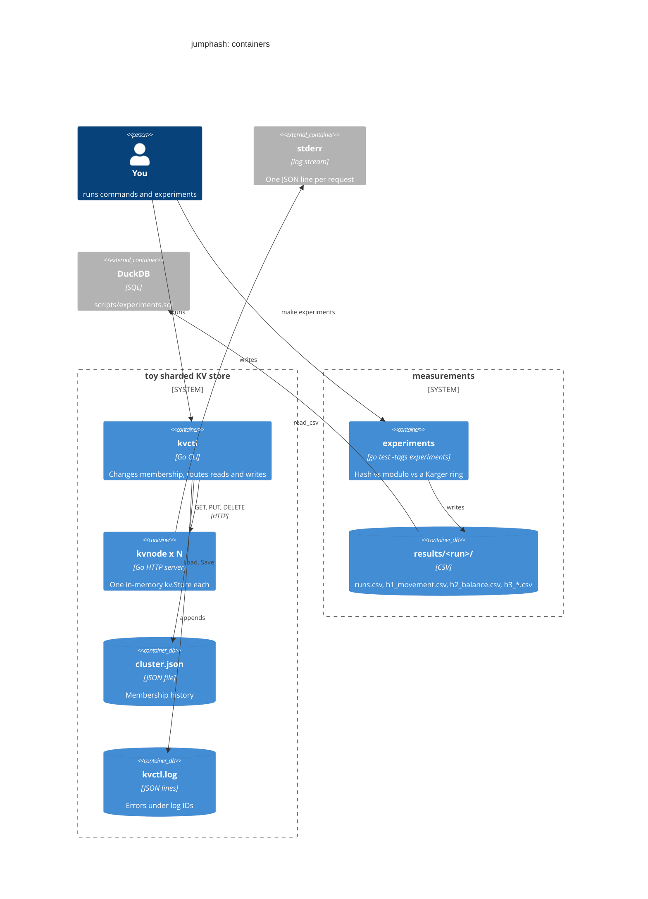
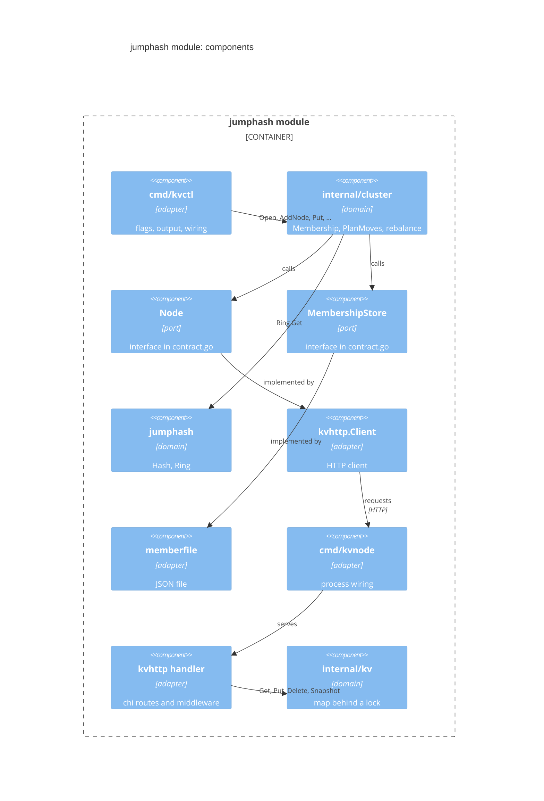
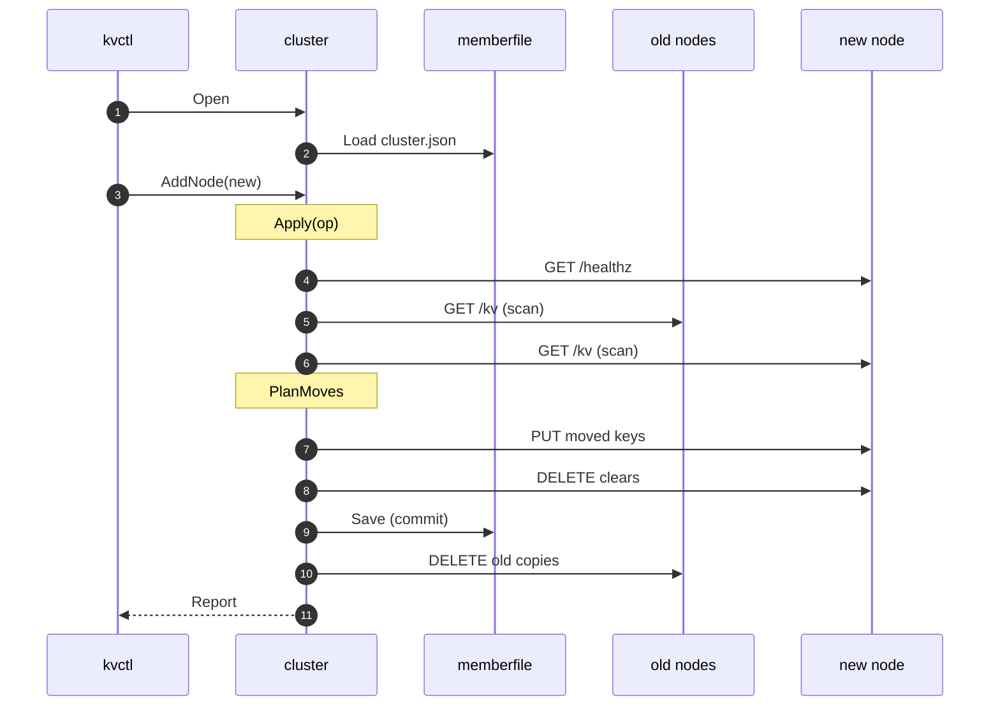

# jumphash: a code walkthrough

> **Diagrams.** Each diagram appears twice: a Mermaid block that GitHub
> renders, and a Unicode text version for terminals. The text versions are
> generated from the sources in [`diagrams/`](diagrams/). After editing a
> `.mmd` source, regenerate them with
> `python3 ~/.claude/skills/draw-visual/scripts/render.py --update docs/walkthroughs/jumphash/code.md`.
> The `.mmd` source and the Mermaid block next to it describe the same
> picture, so change them together.

This walks through the non-test code of [`jumphash/`](../../../jumphash/),
the project for paper 1, Lamping & Veach's *A Fast, Minimal Memory,
Consistent Hash Algorithm* (2014). It starts with the 29-line algorithm and
moves outward: a `Ring` that can lose any node, a one-node key-value store,
the `cluster` package that decides who owns each key and which keys move,
the HTTP and file adapters, the two binaries, and last, the experiments
that measure the paper's claims. The shared helpers from
[`shared/`](../../../shared/) come up where they are first used. The test
side is in [tests.md](tests.md). Paths below are relative to `jumphash/`
unless they start with `shared/`, and `file.go:12` means line 12.

## Reading order

| # | Stop | Files | Kind |
|---|------|-------|------|
| 1 | [The algorithm](#1-the-algorithm-hash) | `jumphash.go` | domain |
| 2 | [Ring: any node can leave](#2-ring-any-node-can-leave) | `ring.go` | domain |
| 3 | [Aside: assertions](#3-aside-sharedassert) | `shared/assert/` | helper |
| 4 | [One node's data](#4-one-nodes-data-kvstore) | `internal/kv/store.go` | domain |
| 5 | [Membership as history](#5-membership-as-history) | `internal/cluster/membership.go` | domain |
| 6 | [PlanMoves: which keys move](#6-planmoves-which-keys-move) | `internal/cluster/plan.go` | domain |
| 7 | [Ports and their contracts](#7-ports-and-their-contracts) | `internal/cluster/contract.go` | domain |
| 8 | [Aside: well-formed errors](#8-aside-sharederrs) | `shared/errs/errs.go` | helper |
| 9 | [Cluster: routing and stats](#9-cluster-routing-stats-and-the-concurrent-scan) | `internal/cluster/cluster.go`, `scan.go` | domain |
| 10 | [Rebalance: copy, commit, clean up](#10-rebalance-copy-commit-clean-up) | `internal/cluster/rebalance.go` | domain |
| 11 | [kvhttp: the node over HTTP](#11-kvhttp-the-node-over-http) | `internal/kvhttp/` | adapter |
| 12 | [memberfile: membership on disk](#12-memberfile-membership-on-disk) | `internal/memberfile/memberfile.go` | adapter |
| 13 | [kvnode](#13-cmdkvnode) | `cmd/kvnode/main.go`, `shared/logx/` | binary |
| 14 | [kvctl and the top level](#14-cmdkvctl-and-the-top-level) | `cmd/kvctl/`, `shared/cli/` | binary |
| 15 | [End to end: `kvctl add-node`](#15-end-to-end-kvctl-add-node) | all of the above | |
| 16 | [Experiments: the hash against its baselines](#16-experiments-the-hash-against-its-baselines) | `experiments/`, `scripts/experiments.sql`, `shared/experiment/` | measurement |

## The running system

C4 container view. GitHub renders the Mermaid; the text version below is
for terminals.



<!-- draw-visual: diagrams/code-containers.mmd -->
```text
┌───────────────────┐
│    you (person)   │
└─────────┬─────────┘
          │
          ├─────────────────────┐
          │                     │
          1                     6
          │                     │
          ▼                     ▼
┌───────────────────┐    ┌────────────┐
│    kvctl (CLI)    ├──┐ │experiments ├─7──┐
└─────────┬─────────┘  3 └────────────┘    └──────────────────────┐
          │            │                                          │
          2            └────────┬───────4───────┐                 │
          ▼                     ▼               ▼                 ▼
┌───────────────────┐    ┌────────────┐    ┌─────────┐    ┌──────────────┐
│kvnode x N (server)│    │cluster.json│    │kvctl.log│    │results/ (CSV)│
└─────────┬─────────┘    └────────────┘    └─────────┘    └───────┬──────┘
          │                                                       │
          5                                                       │
          ▼                                                       │
┌───────────────────┐    ┌────────────┐                           │
│   stderr (logs)   │    │   DuckDB   │◄8─────────────────────────┘
└───────────────────┘    └────────────┘
```

1. You run `kvctl`, one process per command.
2. `kvctl` talks HTTP to each `kvnode`.
3. It loads and saves the membership history in `cluster.json`.
4. It appends errors, with their log IDs, to `kvctl.log`.
5. Each `kvnode` logs one JSON line per request on stderr.
6. `make experiments` runs the `experiments` test package
   ([stop 16](#16-experiments-the-hash-against-its-baselines)). It calls
   `Hash` directly and never starts a node.
7. Each run writes one CSV per table to
   `jumphash/results/<run-id>/`.
8. `scripts/experiments.sql` reads every run with DuckDB and prints the
   blog tables.

There is no coordinator process. `kvctl` is the only thing that knows the
membership, and it re-reads `cluster.json` on every run. Nodes know
nothing about each other or about the cluster.

## The packages

C4 component view of the `jumphash` module. Domain packages do no I/O;
adapters connect them to HTTP, files, and the command line
([coding approach §1](../../coding.md#1-domain-vs-integration)).



<!-- draw-visual: diagrams/code-components.mmd -->
```text
┌────────────────────────┐
│  cmd/kvctl (adapter)   │
└────────────┬───────────┘
             │
             1
             ▼
┌────────────────────────┐
│    cluster (domain)    │
└────────────┬───────────┘
             │
             ├────────────────────────────┬────────────────────────┐
             │                            │                        │
             2                            2                        3
             │                            │                        │
             ▼                            ▼                        ▼
┌────────────────────────┐    ┌──────────────────────┐    ┌─────────────────┐
│      Node (port)       │    │MembershipStore (port)│    │jumphash (domain)│
└────────────┬───────────┘    └───────────┬──────────┘    └─────────────────┘
             │                            │
             4                            4
             ▼                            ▼
┌────────────────────────┐    ┌──────────────────────┐
│kvhttp.Client (adapter) │    │ memberfile (adapter) │
└────────────┬───────────┘    └──────────────────────┘
             │
             5
             ▼
┌────────────────────────┐
│  cmd/kvnode (adapter)  │
└────────────┬───────────┘
             │
             6
             ▼
┌────────────────────────┐
│kvhttp handler (adapter)│
└────────────┬───────────┘
             │
             7
             ▼
┌────────────────────────┐
│      kv (domain)       │
└────────────────────────┘
```

1. `kvctl` calls `cluster.Open`, `AddNode`, `RemoveNode`, `Put`, `Get`,
   `Delete`, `Owner`, and `Stats`.
2. `cluster` reaches nodes and storage only through its two ports, the
   interfaces in `internal/cluster/contract.go`.
3. `Membership.Owner` calls `Ring.Get`, which calls `Hash`.
4. `kvhttp.Client` satisfies `Node`, and `memberfile.File` satisfies
   `MembershipStore`. `kvctl` builds both and passes them to
   `cluster.Open`. `kvhttp` does not import `cluster`: Go interfaces are
   satisfied structurally.
5. The client sends HTTP requests to a `kvnode` process.
6. `kvnode` serves `kvhttp.NewHandler`.
7. The handler reads and writes a `kv.Store`.

Every package also uses the [`shared`](../../../shared/) module: `assert`
for contracts, `errs` for errors that leave a package, `logx` for JSON
logs, and `cli` for `kvctl`'s top level. The diagrams leave those edges out.

## 1. The algorithm: `Hash`

[`jumphash.go`](../../../jumphash/jumphash.go)

This is the paper's algorithm, line for line. `Hash(key, numBuckets)`
returns a bucket in `[0, numBuckets)`, or `-1` when `numBuckets <= 0`.

```go
var b, j int64 = -1, 0
for j < int64(numBuckets) {
	b = j
	key = key*2862933555777941757 + 1
	j = int64(float64(b+1) * (float64(int64(1)<<31) / float64((key>>33)+1)))
}
assert.That(b >= 0 && b < int64(numBuckets), "jumphash: Hash result out of range")
return int32(b)
```
(`jumphash.go:18-28`)

The key seeds a linear congruential generator, so each key follows its
own fixed sequence of jumps. `j` is the next bucket count at which this
key would move. The loop stops at the first jump past `numBuckets`, and
`b` is the last bucket the key landed in.

**Things to notice**

- This loop is the paper's claim in code. When the cluster grows from `n`
  to `n+1` buckets, a key either keeps its bucket or jumps to bucket `n`,
  and about `1/(n+1)` of keys jump. Nothing moves between old buckets.
- The function needs no memory and no table, but it only numbers buckets
  `0..n-1`. You can add or remove only the *last* bucket. Stop 2 fixes
  that.
- Bad input (`numBuckets <= 0`) returns `-1`, not a panic. The range check
  at the end is an assertion: it can fail only if the arithmetic is wrong.

## 2. Ring: any node can leave

[`ring.go`](../../../jumphash/ring.go)

`Ring` maps keys to named nodes and lets any node leave. A removed node's
slot becomes a *hole* instead of shifting the others down.

```go
type Ring struct {
	mu    sync.RWMutex
	slots []string       // bucket index -> node name; "" marks a hole
	index map[string]int // node name -> bucket index
	holes []int          // empty slots, reused most-recent first
}
```
(`ring.go:39-44`)

- `Get` (`ring.go:103-116`) hashes over all slots, holes included. If the
  key lands on a hole, it scrambles the key with `mix64` (the SplitMix64
  finalizer, `ring.go:157`) and tries again.
- `Remove` (`ring.go:83-97`) empties the slot and pushes it onto `holes`.
- `Add` (`ring.go:58-80`) fills the most recent hole, or appends a slot.
- Sentinel errors: `ErrNodeExists`, `ErrNodeNotFound`, `ErrEmptyName`
  (`ring.go:10-14`).

**How it connects to the paper.** Plain jump hash can't remove a middle
bucket. With holes, a removal moves only the removed node's keys, because
no other key's first lookup ever touched that slot. An add fills a hole or
appends, so keys move only onto the new node. Removing a node and adding
it straight back restores the old mapping exactly.

**Things to notice**

- The invariant is in the doc comment (`ring.go:36-38`) and checked by
  `checkInvariant` (`ring.go:140-153`): every slot is a live node recorded
  in `index`, or a hole listed once in `holes`. `Add` and `Remove` run it
  through `defer` after every change, guarded by `if assert.Enabled`
  because it is O(slots). `Get` doesn't run it; it relies on it.
- `Add` registers the invariant check *after* `defer r.mu.Unlock()`, so it
  runs first, while the lock is still held (defers are LIFO).
- Add then remove does *not* restore the mapping when the add appended a
  slot: the new trailing hole re-hashes some keys. `Ring` doesn't promise
  it.
- Lookups take about `slots/live` tries. Many holes slow them down; the
  doc comment points to MementoHash.

## 3. Aside: `shared/assert`

[`shared/assert/assert.go`](../../../shared/assert/assert.go),
[`enabled.go`](../../../shared/assert/enabled.go),
[`disabled.go`](../../../shared/assert/disabled.go)

`assert.That(cond, format, args...)` panics with `"assertion failed: ..."`
when `cond` is false. `assert.Enabled` is a constant: `true` by default,
`false` with `-tags noassert`. With it false, the compiler drops code
inside `if assert.Enabled { ... }`.

Assertions check contracts, never input
([coding approach §2](../../coding.md#2-validation-vs-contracts)). The
rule of thumb: if a typo on the command line could trip the check, it must
return an error instead. `Hash` shows both sides: `numBuckets <= 0` is
input and returns `-1`, while the range check is a contract.

## 4. One node's data: `kv.Store`

[`internal/kv/store.go`](../../../jumphash/internal/kv/store.go)

A `map[string]string` behind a `sync.RWMutex`, with `Get`, `Put`,
`Delete` (reports whether the key was there), `Snapshot` (a copy of every
entry, `store.go:45-49`), and `Len`. Nothing is persisted.

**Things to notice**

- `kv` knows nothing about HTTP or clusters. `kvhttp` serves it
  (stop 11), and the test fake `clustertest.MemNode` wraps it too.
- `Snapshot` returns a clone, so a rebalance scan can't race with later
  writes to the node's map.

## 5. Membership as history

[`internal/cluster/membership.go`](../../../jumphash/internal/cluster/membership.go)

`Membership` is who is in the cluster, stored as the list of add and
remove ops that built it, plus the `Ring` that replaying them produces.

```go
type Op struct {
	Kind string // OpAdd or OpRemove
	Node string
}

type Membership struct {
	history []Op
	ring    *jumphash.Ring
}
```
(`membership.go:14-17`, `35-38`)

- `NewMembership(history)` (`membership.go:45-74`) replays the ops into a
  fresh ring. Bad history (an unknown op, a duplicate add, an unknown
  remove) returns an error, because history can come from a file.
- `Apply(op)` (`membership.go:85-111`) returns a *new* membership with one
  more op. It turns the ring's sentinels into friendly messages such as
  `"%s is already in the cluster"`.
- `Owner(key)` (`membership.go:127-132`) is `ring.Get(KeyHash(key))`.
- `KeyHash` (`membership.go:136-140`) is FNV-1a 64.

**Why history and not a node list?** The ring's mapping depends on which
slots are holes, and that depends on the order of changes. A list of live
nodes would lose the holes. Replaying the history rebuilds the same ring
in every `kvctl` run.

**Things to notice**

- `Membership` is immutable. `rebalance` needs the current and the next
  membership side by side, and `Apply` gives it both.
- `KeyHash` must be stable across processes, so it uses `hash/fnv`, not
  the randomly seeded `hash/maphash` (comment at `membership.go:134-135`).
- The zero value is not `Valid()`, but `Nodes` and `Owner` treat it as
  empty. `Apply` asserts `m.Valid()` as a precondition.
- With assertions on, `Apply` checks its postconditions: exactly one op
  appended, the node present after an add and absent after a remove, and
  the node count changed by one (`membership.go:98-109`).

## 6. PlanMoves: which keys move

[`internal/cluster/plan.go`](../../../jumphash/internal/cluster/plan.go)

`PlanMoves(contents, current, next)` (`plan.go:68-112`) is a pure
function. Given what each node holds now and the membership before and
after a change, it returns a `Plan`:

```go
type Plan struct {
	Moves  []Move // authoritative copies that go to a new owner
	Clears []Drop // stale copies on the key's next owner: delete before the commit
	Drops  []Drop // other stale copies: delete after the commit
}
```
(`plan.go:24-31`, comments shortened)

The rule (`plan.go:39-50`): reads go only to a key's owner, so the owner
under `current` holds the single source of truth. If it has a copy, that
copy is *authoritative*. If it has none, the key doesn't exist, whatever
other nodes hold. For each key:

- an authoritative copy moves to the key's owner under `next`, if that is
  a different node;
- a stale copy on the next owner becomes a **clear**;
- any other stale copy becomes a **drop**;
- if `next` has no nodes but the key is live, `PlanMoves` fails with
  `errLastNode`: you can't remove the last node while it holds keys.

**How it connects to the paper.** The jump hash properties carry over:
on an add every move goes to the new node, and on a remove every move
comes from the removed node. Stale copies don't count as movement,
because they are deleted, never moved.

**Things to notice**

- A pure function can be tested with plain maps, with no fakes at all
  ([coding approach §1](../../coding.md#1-domain-vs-integration)).
- Stale copies are deleted, never copied. Without versions there is no
  way to tell an old copy from a live one, and copying one could
  overwrite a newer value or bring back a deleted key. The README's
  "How data moves" section tells the story of the bugs that taught this.
- `checkPlan` (`plan.go:115-138`) asserts the postconditions listed in
  the doc comment: at most one move per key, each from the authoritative
  copy to the next owner, and no clear or drop of an authoritative copy.
- Keys are visited in sorted order (`slices.Sorted`), so a plan is
  deterministic.

## 7. Ports and their contracts

[`internal/cluster/contract.go`](../../../jumphash/internal/cluster/contract.go)

The domain defines the two interfaces it needs, with a contract on every
method:

```go
type Node interface {
	Health(ctx context.Context) error
	// pre: key != ""; post: err != nil ⇒ value == "" && !ok; !ok ⇒ value == ""
	Get(ctx context.Context, key string) (value string, ok bool, err error)
	Put(ctx context.Context, key, value string) error   // pre: key != ""
	Delete(ctx context.Context, key string) error       // idempotent
	All(ctx context.Context) (entries map[string]string, err error) // non-nil, no "" key
}

type Dialer func(addr string) Node

type MembershipStore interface {
	Load() (m Membership, err error) // post: err == nil ⇒ m.Valid()
	Save(m Membership) error         // pre: m.Valid()
}
```
(`contract.go:27-73`, comments condensed)

Contracts are enforced twice:

1. **At runtime.** `checkedNode`, `checkedStore`, and `checkedDialer`
   (`contract.go:75-133`) wrap every implementation and assert both
   sides of each call. `cluster.Open` installs them.
2. **In tests.** `internal/cluster/clustertest` has one contract suite per
   interface. The real adapters and the in-memory fakes all run it (see
   [tests.md](tests.md#4-contract-tests)).

**Things to notice**

- A failed precondition is a bug in `cluster`. A failed postcondition is
  a bug in the adapter. A network or disk failure is neither: it comes
  back as an error (`contract.go:21-23`).
- `Delete` of a missing key succeeds. That makes clean-up retries safe.
- `All` must return a copy. The scan in stop 9 relies on it.

## 8. Aside: `shared/errs`

[`shared/errs/errs.go`](../../../shared/errs/errs.go)

Every error that leaves a package's public API is an `*errs.Error`
([coding approach §3](../../coding.md#3-error-handling)):

```go
type Error struct {
	Module  string         // the module boundary that wrapped it, e.g. "cluster"
	Message string         // one line, safe to show to a user
	Inner   error          // the cause; nil if this module created the error
	Time    time.Time      // when it was wrapped, in UTC
	Stack   string         // stack trace where the error started
	Misc    map[string]any // extra context: url, path, request ID, ...
}
```
(`errs.go:32-39`)

- `errs.Wrap(module, err, format, args...)` builds one. It captures a
  stack only if `err` doesn't already contain an `*errs.Error`.
- `.With(key, value)` adds context, such as the node, URL, or path.
- `Error()` returns only `Message`, so each message must stand on its own.
- `Unwrap` keeps `errors.Is(err, cluster.ErrEmptyKey)` working.
- `Outermost`, `Chain`, `DeepestStack`, and `Describe` serve the top
  level and the tests.

`cluster` wraps through a one-line helper, `wrap` (`cluster.go:26-28`),
with `Module = "cluster"`.

## 9. Cluster: routing, stats, and the concurrent scan

[`internal/cluster/cluster.go`](../../../jumphash/internal/cluster/cluster.go),
[`scan.go`](../../../jumphash/internal/cluster/scan.go)

```go
type Cluster struct {
	members Membership
	store   MembershipStore
	dial    Dialer
}
```
(`cluster.go:37-41`)

- `Open(store, dial)` (`cluster.go:47-55`) wraps the store and dialer in
  their checkers and loads the membership.
- `Owner(key)` (`cluster.go:64-73`) is where every key operation starts.
  An empty key returns `ErrEmptyKey` and an empty cluster returns
  `ErrEmpty`, both wrapped. So a `Node` never sees an empty key, and the
  `Node` precondition never trips on user input.
- `Put`, `Get`, and `Delete` (`cluster.go:76-108`) call `Owner`, dial that
  node, and wrap any node error with the key and node.
- `Stats` (`cluster.go:122-145`) asks every node for its entries and
  counts keys per node, plus *misplaced* keys: keys the node holds that
  the ring assigns elsewhere. A node that fails is reported as
  `Unreachable`, and the others are still reported.

`scan(ctx, nodes)` (`scan.go:35-56`) starts one goroutine per node. Each
sends a `scanResult{node, entries, err, panic}` on one channel: the Result
pattern from Cox-Buday, chapter 4
([coding approach §5](../../coding.md#5-concurrency)).

**Things to notice**

- The channel is buffered to `len(nodes)`, so no goroutine blocks if the
  parent stops reading. A separate goroutine closes it after
  `wg.Wait()`.
- Each goroutine recovers its own panic and sends it in the result. The
  parent calls `r.repanic()` (`scan.go:60-64`), so the panic surfaces on
  the caller's goroutine, where `kvctl`'s top level can report it as a bug.
- The parent sets the policy. `Stats` reports every node separately;
  `rebalance` (stop 10) stops at the first failure.

## 10. Rebalance: copy, commit, clean up

[`internal/cluster/rebalance.go`](../../../jumphash/internal/cluster/rebalance.go)

`AddNode` (`rebalance.go:24-34`) applies the op, checks the new node's
`Health`, and calls `rebalance`. `RemoveNode` (`rebalance.go:41-48`)
applies the op and calls `rebalance`. Both return a `Report{Node, Scanned,
Moves, Drops}`.

`rebalance(ctx, op, next)` (`rebalance.go:83-172`) runs in three phases:

1. **Copy.** Scan every current node, plus the joining node on an add
   (`rebalance.go:98-101`). On the first scan error, cancel the rest but
   keep reading results, so a panic behind the error is still re-raised.
   Then call `PlanMoves`, PUT each move onto its new owner, and DELETE each
   clear. No current owner is touched, so a failure here changes no read.
2. **Commit.** `c.store.Save(next)`, then `c.members = next`. Routing
   switches here.
3. **Clean up.** DELETE each moved key from its old node, plus every drop.
   None of these is on a key's owner, so a failure leaves only copies
   that no read sees, and the next change deletes them.

Every error says what state the cluster is in and whether a retry is
safe:

```go
return rep, wrap(err, "cannot copy key %q to %s; membership unchanged, safe to retry: %v", m.Key, m.To, err).
	With("key", m.Key).With("from", m.From).With("to", m.To)
```
(`rebalance.go:132-133`)

**How it connects to the paper.** `checkMinimalMovement`
(`rebalance.go:182-191`) asserts the paper's property on every real
rebalance: on an add every move goes to the added node, and on a remove
every move comes from the removed node. It runs before the copy phase.

**Things to notice**

- The order is "copy, then commit, then clean up"
  ([coding approach §6](../../coding.md#6-data-and-state-changes)). A
  failure at any step leaves every key readable.
- The joining node is scanned because it may hold stale copies from an
  earlier membership or a failed copy phase. Without that scan, a
  re-added node served a deleted key (`TestReAddedNodeDoesNotServeStaleCopies`).
- Writes during a rebalance are **not** safe. A write that reaches an old
  owner between copy and commit is deleted in clean-up. The doc comment
  says so (`rebalance.go:65-69`), and so does the README.
- Moves run one request at a time. The doc comment names this as the
  bottleneck and suggests batching per destination.

## 11. kvhttp: the node over HTTP

[`internal/kvhttp/server.go`](../../../jumphash/internal/kvhttp/server.go),
[`logging.go`](../../../jumphash/internal/kvhttp/logging.go),
[`client.go`](../../../jumphash/internal/kvhttp/client.go)

**Server.** `NewRouter(store)` (`server.go:44-101`) exposes a `kv.Store`:

| Method | Path | Result |
|--------|------|--------|
| GET | `/healthz` | `ok` |
| GET | `/kv` | JSON object of every entry |
| GET | `/kv/{key}` | the value, or 404 |
| PUT | `/kv/{key}` | 204; 400 unless key and value are valid UTF-8; 413 over `MaxValueBytes` (1 MiB) |
| DELETE | `/kv/{key}` | 204, or 404 |

`NewHandler` (`server.go:28-30`) wraps the router in middleware, in this
order: `requestID(Logging(logger)(Recover(logger)(router)))`.

- `requestID` (`logging.go:20-25`) gives each request an ID and returns it
  in `X-Request-Id`.
- `Logging` (`logging.go:54-84`) writes one JSON line per request: method,
  path, status, bytes, duration, request ID, and any error a handler
  reported. 5xx logs at error level; 4xx or a reported error at warn.
- `Recover` (`logging.go:89-111`) turns a handler panic into a 500 that
  names the request ID, and logs the stack. It lets
  `http.ErrAbortHandler` through.

**Client.** `Client` (`client.go:18-21`) satisfies `cluster.Node`. All
five methods go through `do` (`client.go:90-118`), the package's module
boundary. Every error that leaves it is an `*errs.Error` from module
`kvhttp` with the method and URL, plus the status and the node's request
ID when the node answered. `NormalizeAddr` (`client.go:130-136`) turns
`localhost:8081` into `http://localhost:8081`, so a node has one name.

**Things to notice**

- PUT refuses invalid UTF-8 (`server.go:81-87`). `GET /kv` sends JSON,
  which would turn bad bytes into U+FFFD, and a rebalance would then copy
  the mangled key. `FuzzKVHTTPRoundTrip` found this.
- Keys are escaped with `url.PathEscape` on the client (`client.go:77`).
  On the server, `keyParam` (`server.go:116-126`) decodes `{key}` only when
  the URL has a `RawPath`, because chi matches on the escaped path then.
  This is how keys like `a/b` and `100%` survive.
- `withKey` asserts the key is non-empty instead of checking it: the route
  pattern can't match an empty segment (`server.go:106-112`).
- A handler can't act on a failed write to a client that hung up, so
  `reportErr` (`logging.go:41-48`) hands the error to `Logging` through a
  slot in the request context. Errors go where they can be logged
  ([coding approach §4](../../coding.md#4-logging)).
- `Client.Delete` accepts 404, which gives `Node.Delete` its idempotence.
  `Client.All` turns JSON `null` into an empty map, to keep the `All`
  postcondition.

## 12. memberfile: membership on disk

[`internal/memberfile/memberfile.go`](../../../jumphash/internal/memberfile/memberfile.go)

`File{Path}` satisfies `cluster.MembershipStore`. The format is:

```json
{
  "history": [
    { "op": "add", "node": "http://localhost:8081" }
  ]
}
```

- `Load` (`memberfile.go:39-60`): a missing file is an empty cluster. An
  unreadable file, bad JSON, or an impossible history (replayed through
  `cluster.NewMembership`) each return a `memberfile` error that names the
  path.
- `Save` (`memberfile.go:64-80`) writes `cluster.json.tmp` and renames it
  over the real file, so a crash never leaves half a file.

**Things to notice**

- The on-disk structs `fileFormat` and `fileOp` are separate from
  `cluster.Op`, so the domain type has no JSON tags.
- `Save` asserts that encoding succeeded: marshalling plain strings can't
  fail.
- `memberfile` imports `cluster` for the `Membership` type. The domain
  never imports the adapter.

## 13. `cmd/kvnode`

[`cmd/kvnode/main.go`](../../../jumphash/cmd/kvnode/main.go),
[`shared/logx/logx.go`](../../../shared/logx/logx.go)

`kvnode -addr :8081 [-quiet]` builds a logger with `logx.New`, serves
`kvhttp.NewHandler(kv.NewStore(), logger)`, and waits for SIGINT or
SIGTERM (`signal.NotifyContext`). It then calls `srv.Shutdown` with a
5-second timeout and exits 0. `-quiet` logs only warnings and errors.

`logx.New(w, level)` returns a JSON `slog` logger whose timestamps are in
UTC, so logs from different processes line up. `logx.NewID()` returns a
random 8-hex-digit log ID. `kvctl` uses both too.

**Things to notice**

- `main` only wires and parses flags. Everything else is in `kv` and
  `kvhttp`.
- Graceful shutdown matters for tests: the e2e harness stops nodes with
  SIGTERM, and a process killed with SIGKILL writes no coverage data.

## 14. `cmd/kvctl` and the top level

[`cmd/kvctl/main.go`](../../../jumphash/cmd/kvctl/main.go),
[`commands.go`](../../../jumphash/cmd/kvctl/commands.go),
[`shared/cli/cli.go`](../../../shared/cli/cli.go)

**Commands.** `run` (`commands.go:21-142`) builds the adapters and opens
the cluster:

```go
dial := func(addr string) cluster.Node { return kvhttp.NewClient(addr) }
c, err := cluster.Open(memberfile.File{Path: path}, dial)
```
(`commands.go:22-23`)

Then it switches on the command: `add-node` and `remove-node` (logged as
`membership changed`, then printed by `printReport`), `nodes`, `stats`,
`put`, `get`, `del`, `where`, and `fill`. Addresses pass through
`kvhttp.NormalizeAddr`. Bad arguments return `userError`, a well-formed
`kvctl` error (`main.go:103-105`). The whole command runs under a 5-minute
timeout.

**The top level.** `realMain` (`main.go:65-97`) parses flags, opens the
log, and hands errors to a `cli.Reporter` from `shared/cli`:

```go
logger, closeLog := cli.OpenLog(*logPath, stderr)
defer closeLog()
logger = logger.With("command", fs.Arg(0), "args", fs.Args()[1:])
r := cli.Reporter{Logger: logger, Stderr: stderr, LogPath: *logPath, Modules: []string{cluster.Module, module}}
defer r.Recover(&code)
```
(`main.go:82-89`)

`shared/cli` is the top level for every command in the repo; `lsmtree`'s
`lsmctl` uses it too.

- `Reporter.Report(err)` (`cli.go:69-76`): if the *outermost* error is an
  `*errs.Error` from one of `Modules` (here `cluster` or `kvctl`), it is a
  known edge case. Log it at warn under a fresh log ID, print
  `error: <message> [log ID 3f9a1c0b]`, and return `ExitError` (1).
- Anything else goes to `Reporter.Bug` (`cli.go:80-85`): log at error
  level, print "something unexpected went wrong. This is a bug", and
  return `ExitBug` (70).
- `Reporter.Recover(&code)` (`cli.go:91-95`) turns a panic, such as a
  failed assertion, into a bug report instead of a goroutine dump.
- `cli.OpenLog` (`cli.go:41-56`) appends JSON lines to the log file,
  creating its directory, and falls back to stderr if it can't.
- Exit codes are `cli.ExitOK`, `ExitError`, `ExitUsage` (2: no command or
  a bad flag), and `ExitBug`; `kvctl` keeps local aliases `exitOK` and so
  on (`main.go:47-52`).

**Things to notice**

- `Outermost` doesn't search the chain. A `kvhttp` error that reaches the
  top without a `cluster` wrapper is reported as a bug, because some
  module skipped its wrapping.
- The log line holds the whole chain (`errs.Chain`), the deepest stack,
  and the command and args. The user sees one line and an ID.
- `runCommand` is a package variable set to `run` (`main.go:100`), a
  test seam that lets `TestPanicIsReportedAsBug` inject a panic.
- The default log path is `kvctl.log` next to the cluster file
  (`main.go:79-81`).

## 15. End to end: `kvctl add-node`

What happens for `bin/kvctl add-node localhost:8083` against a cluster
that already has nodes. The sequence diagram is the same in both forms.



<!-- draw-visual: diagrams/code-add-node.mmd -->
```text
┌───────┐     ┌─────────┐     ┌────────────┐     ┌───────────┐     ┌──────────┐
│ kvctl │     │ cluster │     │ memberfile │     │ old nodes │     │ new node │
└───┬───┘     └────┬────┘     └──────┬─────┘     └─────┬─────┘     └─────┬────┘
    │              │                 │                 │                 │
    │ 1. Open      │                 │                 │                 │
    ├─────────────►│                 │                 │                 │
    │              │                 │                 │                 │
    │              │ 2. Load cluster.json              │                 │
    │              ├────────────────►│                 │                 │
    │              │                 │                 │                 │
    │ 3. AddNode(new)                │                 │                 │
    ├─────────────►│                 │                 │                 │
    │              │                 │                 │                 │
    │        ┌───────────┐           │                 │                 │
    │        │ Apply(op) │           │                 │                 │
    │        └───────────┘           │                 │                 │
    │              │                 │                 │                 │
    │              │ 4. GET /healthz │                 │                 │
    │              ├────────────────────────────────────────────────────►│
    │              │                 │                 │                 │
    │              │ 5. GET /kv (scan)                 │                 │
    │              ├──────────────────────────────────►│                 │
    │              │                 │                 │                 │
    │              │ 6. GET /kv (scan)                 │                 │
    │              ├────────────────────────────────────────────────────►│
    │              │                 │                 │                 │
    │        ┌───────────┐           │                 │                 │
    │        │ PlanMoves │           │                 │                 │
    │        └───────────┘           │                 │                 │
    │              │                 │                 │                 │
    │              │ 7. PUT moved keys                 │                 │
    │              ├────────────────────────────────────────────────────►│
    │              │                 │                 │                 │
    │              │ 8. DELETE clears│                 │                 │
    │              ├────────────────────────────────────────────────────►│
    │              │                 │                 │                 │
    │              │ 9. Save (commit)│                 │                 │
    │              ├────────────────►│                 │                 │
    │              │                 │                 │                 │
    │              │ 10. DELETE old copies             │                 │
    │              ├──────────────────────────────────►│                 │
    │              │                 │                 │                 │
    │ 11. Report   │                 │                 │                 │
    │◄┈┈┈┈┈┈┈┈┈┈┈┈┈┤                 │                 │                 │
    │              │                 │                 │                 │
```

Step by step, with the code each step runs:

1. **Parse and set up** (`main.go:65-89`). `realMain` parses flags, opens
   `kvctl.log` with `cli.OpenLog`, builds the `cli.Reporter`, and defers
   `r.Recover(&code)`.
2. **Open** (`commands.go:22-23`, `cluster.go:47-55`). `run` builds the
   dialer and `memberfile.File`; `cluster.Open` wraps them in their
   checkers and calls `File.Load`, which replays the history into a
   `Membership` and its `Ring` (steps 1-2 in the diagram).
3. **Normalize** (`commands.go:47`). `localhost:8083` becomes
   `http://localhost:8083`.
4. **Apply** (`rebalance.go:25-29`). `Membership.Apply` builds `next`. A
   duplicate add or an empty name fails here, before any I/O.
5. **Health** (`rebalance.go:30-32`). `GET /healthz` on the new node. If
   it isn't running, the error says "nothing changed".
6. **Scan** (`rebalance.go:94-116`). `scan` runs `GET /kv` on every
   current node and the new node, in parallel.
7. **Plan** (`rebalance.go:118-127`). `PlanMoves` decides moves, clears,
   and drops; `checkMinimalMovement` asserts every move goes to the new
   node.
8. **Copy** (`rebalance.go:130-143`). `PUT /kv/{key}` for each move, then
   `DELETE` for each clear, all on the new node.
9. **Commit** (`rebalance.go:146-149`). `File.Save` writes
   `cluster.json.tmp` and renames it.
10. **Clean up** (`rebalance.go:161-170`). `DELETE /kv/{key}` on each old
    owner, plus the drops.
11. **Report** (`commands.go:51-56`, `144-171`). `run` logs
    `membership changed` and prints `add-node <addr>: scanned N keys, moved
    M (P%) in T`, with per-node counts. `realMain` logs `command ok` and
    returns 0.

On the node side, every request passes through `requestID`, `Logging`,
and `Recover` before the router touches the `kv.Store`, and each one leaves
a JSON line on that node's stderr.

If any step fails, the error travels back up as a `cluster` error,
`Reporter.Report` prints its message with a log ID and returns 1, and the
full chain, including the node's `request_id`, is in `kvctl.log`.

## 16. Experiments: the hash against its baselines

[`experiments/`](../../../jumphash/experiments/),
[`scripts/experiments.sql`](../../../jumphash/scripts/experiments.sql),
[`shared/experiment/experiment.go`](../../../shared/experiment/experiment.go)

The cluster shows the paper's claim on a few thousand keys. The
experiments measure the claims directly, on `Hash` alone: H1 minimal
movement, H2 balance, and H3 the cost of a lookup. They are Go tests
behind the `experiments` build tag, so they can use `testing`'s
parallel subtests and `t.Log`, but they are not part of `make check`.
Every file is a `_test.go` file: the package has no code anything else
imports. Read them in this order:

1. **`helpers_test.go`.** The package doc lists the three claims.
   `TestMain` hands over to `experiment.Main` from `shared/experiment`,
   which opens the run directory when `EXPERIMENT_RESULTS_DIR` is set.
   `sampleKeys` draws a fixed key sample from a seeded PCG, one seed per
   experiment, so the numbers never change between runs.
2. **`baselines_test.go`.** The two schemes jump hash is measured
   against. `modulo` is `key % n`. `kargerRing` is the ring the paper's
   "Related work" describes: each bucket gets `v` points on the 64-bit
   circle, and a key goes to the first point at or after its position.

   ```go
   func (r *kargerRing) get(key uint64) int32 {
   	i, _ := slices.BinarySearch(r.points, mix64(key))
   	if i == len(r.points) {
   		i = 0
   	}
   	return r.buckets[i]
   }
   ```
   (`baselines_test.go:87-93`)

   A bucket's points depend only on its number (`ringPoint`), so a ring
   of n+1 buckets is the ring of n plus the new bucket's points; `without`
   strips them out again without re-sorting. `keyspaceShares` adds up
   the arcs each bucket owns, which is exactly the paper's Figure 2
   metric, with no sampling noise. This is not `jumphash.Ring` (stop 2),
   which is jump hash with holes.
3. **`h1_movement_test.go`.** `measureMovement` hashes every key before
   and after adding bucket `n` and counts moved keys, *misplaced* keys
   (moved, but not to `n`), and the donor buckets they left. One
   `experiment.Sweep` config per n runs jump, modulo, and the ring at
   four values of `v` side by side.
4. **`h2_balance_test.go`.** Counts keys per bucket and compares the
   standard deviation with the binomial √(K·p·(1-p)), the spread perfect
   randomness would give. For the ring it also reports the exact
   key-space σ/μ, the paper's Figure 2 value, and the bytes of state.
5. **`h3_jumps_test.go`.** Counting loop iterations needs a copy of
   `Hash` with a counter:

   ```go
   func hashCounting(key uint64, numBuckets int32) (bucket int32, iterations int) {
   	var b, j int64 = -1, 0
   	for j < int64(numBuckets) {
   		iterations++
   		b = j
   		key = key*2862933555777941757 + 1
   		j = int64(float64(b+1) * (float64(int64(1)<<31) / float64((key>>33)+1)))
   	}
   	return int32(b), iterations
   }
   ```
   (`h3_jumps_test.go:114-123`)

   A copy can drift from the original, so the test compares its bucket
   with `jumphash.Hash` for every key and every n it measures
   (`h3_jumps_test.go:60-62`). `harmonic` gives the expectation, and
   `fitLine` fits the means to a·ln(n) + b.
6. **`scripts/experiments.sql`.** It names its four tables and loads
   the shared
   [`experiments_prelude.sql`](../../../shared/scripts/experiments_prelude.sql),
   which checks every table has a run, lists the runs, and defines
   `latest('<table>')`, the rows of the newest run that wrote
   `results/*/<table>.csv`. The views `h1`, `h2`, `h3`, and `h3_fit` are
   one `latest` each; then come one query per blog table and a cross-run
   comparison of the headline numbers over `runs_of('<table>')`.

**How it connects to the paper.**

- H1 is the monotonicity property from the paper's introduction: keys
  move only from old buckets to the new one, and only 1/(n+1) of them.
- H2 is "Key Distribution" and "Space Requirements": the ring's σ/μ is
  about 1/√v, and its points cost memory, while jump needs none.
- H3 is "Performance Analysis": the loop runs once per jump destination
  below n, plus one, so its expected count is the harmonic number H_n,
  which the paper bounds by ln(n) + 1.

**Things to notice**

- Nothing is timed. Counting keys and iterations makes every run give
  the same numbers, and leaves the paper's "Execution Time" table to
  benchmarks.
- Each test asserts only a loose shape (jump within 5σ of 1/(n+1), zero
  misplaced keys, ring at v = 1 at least 10× worse than binomial, the
  mean iterations within 5 standard errors of H_n), so the suite is also
  a regression check on `Hash`.
- `experiment.Sweep` runs the configurations as parallel subtests. They
  share only the read-only key slice. The whole suite takes about a
  second.
- The project's [README](../../../jumphash/README.md#experiments-measuring-the-papers-claims)
  has the results and how they compare with the paper.

Where to go next: [tests.md](tests.md) walks through how each of these
stops is tested, and the [project README](../../../jumphash/README.md)
covers usage and what is deliberately missing.
