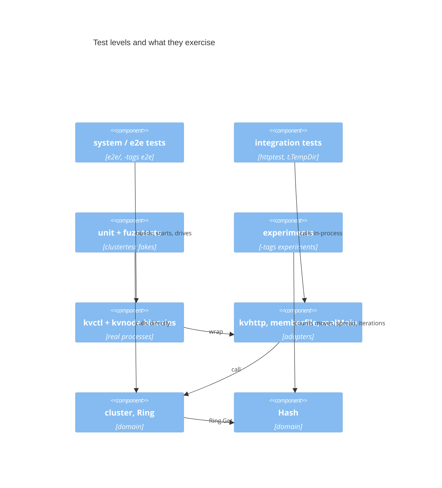

# jumphash: a test walkthrough

> **Diagrams.** Each diagram appears twice: a Mermaid block that GitHub
> renders, and a Unicode text version for terminals. The text version is
> generated from the source in [`diagrams/`](diagrams/). After editing a
> `.mmd` source, regenerate it with
> `python3 ~/.claude/skills/draw-visual/scripts/render.py --update docs/walkthroughs/jumphash/tests.md`.
> The `.mmd` source and the Mermaid block next to it describe the same
> picture, so change them together.

This walks through every test file in [`jumphash/`](../../../jumphash/),
grouped as in [`jumphash/TESTS.md`](../../../jumphash/TESTS.md), which
follows the categories in the repo's [testing approach](../../testing.md).
For each group it says what that kind of test buys, then for each file
what it checks, a test worth reading, and a command that runs just that
file. The code itself is in [code.md](code.md).

Every command runs from the repository root. `go -C jumphash` runs `go`
inside `jumphash/`; add `-v` to see each test by name. A fuzz command
without `-fuzz` runs only the seed corpus and saved failures, which is
what plain `go test` does. The e2e and experiments suites need their build
tags (`-tags e2e`, `-tags experiments`).

## The pyramid

Which components each level of test exercises. GitHub renders the
Mermaid; the text version below is for terminals.



<!-- draw-visual: diagrams/tests-pyramid.mmd -->
```text
┌──────────────────┐    ┌───────────┐    ┌───────────┐    ┌───────────┐
│    e2e tests     │    │integration│    │unit + fuzz│    │experiments│
└─────────┬────────┘    └─────┬─────┘    └─────┬─────┘    └─────┬─────┘
          │                   │                │                │
          1                   │                │                │
          ▼                   │                │                │
┌──────────────────┐          │                │                │
│  kvctl + kvnode  │          │                │                │
└─────────┬────────┘          │                │                │
          │                   │                │                │
          5                   │                │                │
          ▼                   │                │                │
┌──────────────────┐          │                │                │
│adapters, realMain│◄───2─────┘          ┌─────┘                │
└─────────┬────────┘                     │                      │
          │                              │                      │
          5                              │                      │
          ▼                              │                      │
┌──────────────────┐                     │                      │
│  cluster, Ring   │◄3───────────────────┘                      │
└─────────┬────────┘                                      ┌─────┘
          │                                               │
          5                                               │
          ▼                                               │
┌──────────────────┐                                      │
│       Hash       │◄─────────────────4───────────────────┘
└──────────────────┘
```

1. e2e tests build `kvctl` and `kvnode`, start nodes on free ports, and
   drive them only through the CLI. They check results by asking each node
   directly with `GET /kv`.
2. Integration tests run one adapter against real infrastructure in the
   same process: an `httptest` server, a temp dir, or `realMain` with a
   temp cluster file.
3. Unit and fuzz tests call the domain directly, `Hash` included.
   `cluster` tests use the in-memory fakes from `clustertest` instead of
   nodes and files.
4. The experiments call `Hash` (and their own baselines) directly over
   seeded key samples, and compare the counts with the paper's claims.
5. Each level also runs everything below it. The adapters are
   `kvhttp`, `memberfile`, and `kvctl`'s `realMain`.

The contract suites in `clustertest` sit across levels 2 and 3: the same
suite runs against the fakes and against the real adapters, so a unit
test that passes over a fake says something about the real system.

| Level | Files | Speed |
|-------|-------|-------|
| Unit | groups 1–3, the domain fuzz targets, and the fake contract runs | milliseconds |
| Integration | group 6, the adapter fuzz targets, and the adapter contract runs | ms to seconds |
| System / e2e | group 7 | seconds; builds the binaries first |
| Measurement | group 8 | about a second; `-tags experiments` |

## 1. Specification-based unit tests

**What they buy.** Each test comes from a documented rule: the paper's
claims for `Hash`, `Ring`'s doc comment, the `cluster` method specs. They
pick partitions and boundaries (0, 1, many buckets; an empty key; an empty
cluster; the last node), so a wrong answer for a whole class of input
shows up as one named failure. They run in milliseconds with no I/O, so
most business rules are tested here. They don't find inputs nobody
thought of; group 5 does that.

### `jumphash_test.go`

`Hash` against the paper: invalid bucket counts return `-1`, one bucket
always gives 0, results are deterministic and in range, keys spread
evenly over 10 buckets (within 3%), plus `BenchmarkHash`.

Worth reading: `TestMonotoneAndMinimalMovement` grows from `n` to `n+1`
buckets for `n` up to 49 over 100,000 keys. It fails if any key moves
anywhere but the new bucket, and checks that about `1/(n+1)` move. That
is the paper's central claim as a test.

```sh
go -C jumphash test -run 'TestInvalidBuckets|TestSingleBucket|TestDeterministic|TestRange|TestMonotoneAndMinimalMovement|TestUniformDistribution' .
go -C jumphash test -run '^$' -bench 'BenchmarkHash$' .
```

### `ring_test.go`

`Ring`: add and remove errors, an empty ring, removing a middle node moves
only its keys, adding moves keys only onto the new node (appended or
filling a hole), remove then add restores the mapping, and balance after
removals. Also `BenchmarkRingGet` and one structural test,
`TestRingInvariantCatchesCorruption` (see group 3).

Worth reading: `TestRingAddIntoHoleMovesKeysOnlyToNewNode`, which shows
that filling a hole keeps the minimal-movement property, and
`TestRingRemoveThenAddRestoresMapping`.

```sh
go -C jumphash test -run 'TestRing' .
go -C jumphash test -run '^$' -bench 'BenchmarkRingGet$' .
```

### `internal/cluster/cluster_test.go`

`cluster` rules over in-memory fakes (`newFixture`): adding a fourth node
moves about a quarter of 3,000 keys, all onto the new node; removing a node
moves exactly its keys; duplicate adds, unknown removes, empty names, and
removing the last node while it holds data are all rejected without a
save; an empty key is an error, not a panic; a dead source aborts before
commit; an empty cluster returns `ErrEmpty`; `PlanMoves` is pure; a key
planted on the wrong node is reported as misplaced and dropped, not
"repaired".

Worth reading: `TestMisplacedKeyIsReportedAndDropped` (the
single-source-of-truth rule in one test) and `TestPlanMovesIsPure`, which
tests `PlanMoves` with nothing but maps.

```sh
go -C jumphash test -run 'TestAddAndRemoveMoveTheRightKeys|TestMembershipChangesAreValidated|TestEmptyKeyIsAnErrorNotAPanic|TestDeadSourceAbortsBeforeCommit|TestEmptyCluster|TestPlanMovesIsPure|TestMisplacedKeyIsReportedAndDropped|TestMinimalMovementInvariantCatchesBadPlan' ./internal/cluster
```

`TestMinimalMovementInvariantCatchesBadPlan` lives here but is structural
(group 3): it hands `CheckMinimalMovement` a bad plan and expects the
assertion to trip.

The `errs`, `assert`, and `cli` helpers are tested in the `shared` module:

```sh
go -C shared test ./...
```

## 2. Failure-path and regression unit tests

**What they buy.** Spec tests check the happy path and input errors. These
tests make a fake node or store fail at one exact step and check three
things: what the error promises, where the data is, and whether
membership changed. Faults are hard to cause with real processes, and a
fake's switches (`Down`, `FailPuts`, `FailDeletes`, `LoadErr`, `SaveErr`)
cause them precisely. The regression tests pin bugs that the fuzzer found
once, so they stay fixed.

### `internal/cluster/failure_test.go`

Each rebalance phase failing: a copy failure and a clear failure change
nothing; a save failure commits nothing; a clean-up failure commits the
change, keeps every key readable, reports the leftovers as misplaced, and
the next change deletes them. Also node errors on `Put`/`Get`/`Delete`,
a failed `Load` in `Open`, and `Membership` edge cases (the zero value,
an unknown op).

Worth reading: `TestRebalanceCleanUpFailureKeepsDataSafe`, and the helper
`requireClusterError`, which checks module, cause, and the promise in the
message ("safe to retry", "data is safe").

```sh
go -C jumphash test -run 'TestRebalance(Copy|Clear|Save|CleanUp)|TestKeyOperationsReportNodeErrors|TestOpenReportsLoadFailure|TestMembershipEdgeCases' ./internal/cluster
```

### `internal/cluster/stale_test.go`

Stale-copy regressions: an old copy left by a failed clean-up never
overwrites a newer value; a key deleted after a failed clean-up stays
deleted; a node that left with data and rejoins doesn't serve its stale
copies; and `PlanMoves`' rule for keys held by more than one node.

Worth reading: `TestDeletedKeyStaysDeletedAfterFailedCleanUp` and
`TestReAddedNodeDoesNotServeStaleCopies`. `FuzzClusterModel` found both
bugs. Their doc comments tell each story step by step.

```sh
go -C jumphash test -run 'TestStaleCopyNeverOverwritesNewerValue|TestDeletedKeyStaysDeletedAfterFailedCleanUp|TestReAddedNodeDoesNotServeStaleCopies|TestPlanPicksTheAuthoritativeCopy' ./internal/cluster
```

### `internal/cluster/errors_test.go`

Every public error is a well-formed `cluster` error whose message stands
on its own and still matches its sentinel with `errors.Is` (a table of
seven cases); `Stats` reports one down node without hiding the others; a
panic in a scan goroutine reaches the caller; and `rebalance` never drops
a panic behind another node's error.

Worth reading: `TestRebalanceNeverDropsAPanicBehindAnError`. It tests the
rule "read every result, even after the first error"
([coding approach §5](../../coding.md#5-concurrency)).

```sh
go -C jumphash test -run 'TestPublicErrorsAreWellFormed|TestStatsReportsEachNodeIndependently|TestScanPanicReachesCaller|TestRebalanceNeverDropsAPanicBehindAnError' ./internal/cluster
```

## 3. Structural tests: proving the assertions can fail

**What they buy.** An assertion that has never failed proves nothing: it
might check the wrong thing, or never run. Coverage marks these failing
branches as uncovered. These tests feed each contract a broken input on
purpose and expect the panic. They catch a check that was deleted, typed
backwards, or compiled out by mistake. They skip under `-tags noassert`.

### `internal/cluster/contract_test.go`

Drives each pre- and postcondition of `Node`, `MembershipStore`, `Dialer`,
and `Open` through the checked wrappers with a stub that breaks it, and
checks the assertion message.

Worth reading: `TestNodeContractIsAsserted`, a table of broken `Get` and
`All` results (a value alongside an error, a nil map, an empty key).

```sh
go -C jumphash test -run 'Test(Node|Store|Dialer)ContractIsAsserted|TestOpenRequiresStoreAndDialer' ./internal/cluster
```

### `internal/cluster/export_test.go`

Not a test. It exposes `CheckMinimalMovement`, `CheckedDialer`,
`CheckedStore`, and `CheckedNode` to the external `cluster_test` package.
It compiles only during tests, so it runs with any of the
`./internal/cluster` commands above.

Two more structural tests sit in other files:
`TestRingInvariantCatchesCorruption` in `ring_test.go` and
`TestMinimalMovementInvariantCatchesBadPlan` in `cluster_test.go`.

```sh
go -C jumphash test -run 'TestRingInvariantCatchesCorruption' .
```

## 4. Contract tests

**What they buy.** `cluster`'s unit tests run over fakes. If a fake
behaves differently from the real adapter, say it errors on deleting a
missing key, those tests pass and prove nothing. One suite per interface,
run against every implementation, keeps the fakes honest (Liskov
substitution). It catches drift between a fake and a real adapter, which
neither unit nor integration tests can see alone.

### `internal/cluster/clustertest/fakes.go`

Not a test file. `MemNode` is a `cluster.Node` over a `kv.Store`, with
`Down`, `FailPuts`, and `FailDeletes` switches; `MemStore` keeps a
`Membership` in memory, counts `Saves`, and has `LoadErr` and `SaveErr`.
`ErrDown` is what a failing `MemNode` returns.

### `internal/cluster/clustertest/contract.go`

The shared suites: `NodeContract(t, newNode)` and `StoreContract(t,
newStore)`. Each subtest is one documented pre- or postcondition, such as
"get missing returns empty, not ok, no error" or "save then load returns
the same history and ring".

### `internal/cluster/clustertest/clustertest_test.go`

Runs both suites against the fakes. The real adapters run the same suites
in `TestClientNodeContract` (`internal/kvhttp/kvhttp_test.go`) and
`TestFileStoreContract` (`internal/memberfile/memberfile_test.go`).

```sh
go -C jumphash test -v ./internal/cluster/clustertest
go -C jumphash test -run 'TestClientNodeContract' -v ./internal/kvhttp
go -C jumphash test -run 'TestFileStoreContract' -v ./internal/memberfile
```

## 5. Property-based and fuzz tests

**What they buy.** Instead of picked examples, each target states a
property that must hold for every input, and Go's coverage-guided fuzzer
searches for an input that breaks it. Model-based targets read the input
as a script of operations and compare the real system with a trivial
model, so they find bad *sequences* nobody would write by hand. With
assertions on, every contract in the code is an extra oracle on every
input. The seeds and saved failures run with plain `go test`, so a found
bug becomes a permanent regression test.

Run a target's seeds with `-run`, or search for new failures with
`-run='^$' -fuzz=<Target>`; one target at a time.

### `jumphash_fuzz_test.go`: `FuzzHash`

For any key and bucket counts `n` and `m`: `n <= 0` gives `-1`, otherwise
the result is in range; growing to `n+1` keeps the key or moves it to
bucket `n`; growing to any `m > n` never moves it to another old bucket.
The seeds include `MaxUint64` and bucket counts near `MaxInt32`.

```sh
go -C jumphash test -run 'FuzzHash' .
go -C jumphash test -run '^$' -fuzz '^FuzzHash$' -fuzztime 30s .
```

### `ring_fuzz_test.go`: `FuzzRingOps`

Each input byte is one ring op on nodes `n0`..`n7`: add, remove, or
remove-then-re-add. A set of live nodes is the model. After each step:
the invariant holds, errors match the model, `Len` and `Nodes` match,
`Get` returns a live node, adds and removes move only the keys they
should, remove-then-re-add restores every owner, and `Get` returns a
key's first slot whenever that slot is live. The fuzzer also picks the
seed for the sampled keys.

```sh
go -C jumphash test -run 'FuzzRingOps' .
go -C jumphash test -run '^$' -fuzz '^FuzzRingOps$' -fuzztime 30s .
```

### `internal/cluster/plan_fuzz_test.go`: `FuzzPlanMoves`

Random memberships (`history`, then `change` on top) and random contents
on any pool node. Applying the plan in memory, in `rebalance`'s order: it
fails exactly when `next` is empty and a key is live; at most one move
per key; after copy and clears, reads under `current` and `next` both
match the reads before, so the commit changes no read; clean-up never
touches a key's next owner; and afterwards each live key is only on its
next owner.

```sh
go -C jumphash test -run 'FuzzPlanMoves' ./internal/cluster
go -C jumphash test -run '^$' -fuzz '^FuzzPlanMoves$' -fuzztime 30s ./internal/cluster
```

### `internal/cluster/model_fuzz_test.go`: `FuzzClusterModel`

The most valuable test in the project. Each two-byte op is add, remove,
put, delete, or a fault: toggle a node down, toggle failing deletes, or
give a node a put budget so a copy phase fails part-way. The model is a
set of members and a map of data. After every op: membership errors
happen exactly when the model says; an error that doesn't say
"membership changed" changed nothing; every reachable key reads the model's
value (no lost writes, stale reads, or resurrected deletes); every error
is a well-formed `cluster` error; every move goes to the key's owner; no
assertion fires. Writes during a rebalance are not modelled, because the
design documents them as unsafe.

Worth reading: the seed scripts in `FuzzClusterModel`, each a small story
(a failed clean-up, then delete, then re-add), and `modelRun.check`.

```sh
go -C jumphash test -run 'FuzzClusterModel' ./internal/cluster
go -C jumphash test -run '^$' -fuzz '^FuzzClusterModel$' -fuzztime 30s ./internal/cluster
```

### `internal/cluster/testdata/fuzz/FuzzClusterModel/`

Saved failing input `1c226bc34f4e34e9`, a script the fuzzer found and
shrank. Plain `go test` reruns it as a subtest of `FuzzClusterModel`:

```sh
go -C jumphash test -run 'FuzzClusterModel/1c226bc34f4e34e9' -v ./internal/cluster
```

### `internal/kvhttp/kvhttp_fuzz_test.go`: `FuzzKVHTTPRoundTrip`

For any non-empty key and value, through the real `Client` and router
over one shared `httptest` server: put then get returns the value, `All`
holds exactly that entry, and delete then get finds nothing. Invalid
UTF-8 must be refused and leave nothing behind. It mostly tests path
escaping, and it found the UTF-8 bug described in
[code.md](code.md#11-kvhttp-the-node-over-http). It is an adapter test
with real HTTP, so it belongs at the integration level of the pyramid.

```sh
go -C jumphash test -run 'FuzzKVHTTPRoundTrip' ./internal/kvhttp
go -C jumphash test -run '^$' -fuzz '^FuzzKVHTTPRoundTrip$' -fuzztime 30s ./internal/kvhttp
```

### `internal/memberfile/memberfile_fuzz_test.go`: `FuzzMemberfileLoad`

Arbitrary bytes as `cluster.json`. `Load` never panics: it returns a
valid membership or a `memberfile` error that names the path. A loaded
membership survives save then load with the same history and nodes.

```sh
go -C jumphash test -run 'FuzzMemberfileLoad' ./internal/memberfile
go -C jumphash test -run '^$' -fuzz '^FuzzMemberfileLoad$' -fuzztime 30s ./internal/memberfile
```

## 6. Integration tests

**What they buy.** Unit tests never touch HTTP, JSON, or the file system,
so they can't catch an escaping bug, a wrong status code, a bad file
format, or an error that leaves an adapter unwrapped. These tests run one
adapter against real infrastructure inside the test process
(`httptest.NewServer`, `t.TempDir()`), including the failure paths: a
server that is down, a corrupt file, a path that is a directory.

### `internal/kvhttp/kvhttp_test.go`

The client against a real server: the `Node` contract suite
(`TestClientNodeContract`), an empty key gets a 4xx, keys like
`with/slash` and `pct%25` round-trip, a value of exactly `MaxValueBytes`
is accepted and one byte more gets 413 with nothing stored, and the
client's 413 error is well-formed.

Worth reading: `TestPutValueSizeLimit`, an on-point / off-point boundary
test.

```sh
go -C jumphash test -run 'TestClientNodeContract|TestServerRejectsEmptyKey|TestClientServerRoundTrip|TestPutValueSizeLimit|TestClientPutTooLargeIsWellFormed' ./internal/kvhttp
```

### `internal/kvhttp/errors_test.go`

Client errors are well-formed `kvhttp` errors with the URL, status, and
the node's request ID; bad replies (bad JSON from `All`, JSON `null`
read as an empty map, a connection that dies mid-body, an unreachable
node, an invalid base URL, a cancelled context); `NormalizeAddr`; the request log carries request IDs; a
handler panic becomes a 500 that names the request ID; a failed write
reaches the log; 5xx logs at error level; `http.ErrAbortHandler` passes
through `Recover`; an unreadable PUT body gets 400.

Worth reading: `TestClientErrorsAreWellFormed`, "node refuses, with its
request ID", which is how a CLI log line is matched to a node log line.

```sh
go -C jumphash test -run 'TestClientErrorsAreWellFormed|TestClientReportsBadReplies|TestNormalizeAddr|TestServerLogsRequestsWithIDs|TestRecoverTurnsPanicInto500|TestHandlerWriteErrorReachesTheLog|TestServerErrorsAreLoggedAtErrorLevel|TestRecoverPassesOnAbortHandler|TestPutWithUnreadableBodyIsBadRequest' ./internal/kvhttp
```

### `internal/memberfile/memberfile_test.go`

The file store in a temp dir: the `MembershipStore` contract suite
(`TestFileStoreContract`), the on-disk JSON format, a corrupt file and an
impossible history are errors, every error is a `memberfile` error naming
the path, and a path that is a directory fails on both load and save.

```sh
go -C jumphash test -run '^Test' ./internal/memberfile
```

### `cmd/kvctl/main_test.go`

`realMain` in-process with a temp cluster file: a known edge case exits 1
with its message and a log ID, and the log line under that ID is JSON at
warn level with the chain and a UTC time; bad arguments exit 1 with no
"bug" wording; a raw error given to `cli.Reporter` is a bug (exit 70);
a panic injected through `runCommand` is reported as a bug with the
stack in the log and no goroutine dump on screen. With two
`kvhttp.NewHandler` servers from `httptest`, it also checks values
(empty and overwritten), keys that need escaping, and argument errors.

Worth reading: `TestPanicIsReportedAsBug` and the helper `findLog`, which
follows the log ID from stderr into `kvctl.log`. The generic `Reporter`
behaviour is tested in `shared/cli/cli_test.go`.

```sh
go -C jumphash test -v ./cmd/kvctl
```

## 7. System / e2e tests

**What they buy.** Only these run the real binaries as separate
processes: flag parsing, process start-up and graceful shutdown, real
ports, the membership file shared between runs, and the CLI's output
format. They catch wiring bugs that every in-process test misses. They
take seconds, so they cover only the main flows and the riskiest failures.
They don't trust the CLI's report: they ask each node directly what it
holds. They need `-tags e2e`.

### `e2e/harness_test.go`

`TestMain` builds `kvnode` and `kvctl` once into a temp dir. `startNode`
starts a node on a free port with `-quiet` and polls `/healthz`;
`t.Cleanup` stops it with SIGTERM. `node.Kill` sends SIGKILL to simulate a
crash. `holdings` and `placement` read every node with `GET /kv` and fail
if a key is on two nodes. `assertAllReadable` reads keys back through the
CLI and requires `misplaced=0` in `kvctl stats`. It has no tests of its
own; any e2e command uses it.

### `e2e/e2e_test.go`

The main flows: single-node CRUD; 3 → 4 nodes moves about a quarter of the
keys, all to the new node; removing a node moves exactly its keys; a
replacement node inherits exactly the removed node's keys (the hole is
reused); 1 → 5 → 1 nodes with a logged moves table; an unreachable node
can't join; a dead source aborts `add-node` with membership and data
untouched; guard rails; and a failure prints a log ID whose log line has
the full chain.

Worth reading: `TestScaleOutMovesOnlyOntoNewNode` (the paper's claim
through real processes) and `TestLifecycleGrowThenShrink`, whose `-v`
output is the moves table in the project README.

```sh
go -C jumphash test -tags e2e -count=1 -run 'TestSingleNodeCRUD|TestScaleOutMovesOnlyOntoNewNode|TestScaleInMovesOnlyRemovedNodesKeys|TestReplacementNodeInheritsExactKeySet|TestLifecycleGrowThenShrink|TestAddUnreachableNodeIsRejected|TestRebalanceAbortsWhenSourceNodeIsDown|TestMembershipGuardRails|TestFailureGivesLogIDWithFullDetails' -v ./e2e
go -C jumphash test -tags e2e -count=1 -run 'TestLifecycleGrowThenShrink' -v ./e2e
```

### `e2e/model_test.go`

`TestWorkloadMatchesModel`: 150 fixed-seed steps of puts (some empty),
overwrites, deletes, adds, removes, and a dead-node add over five nodes
and keys such as `with/slash`, `100%`, and `?q=1#f`, checked against a
map. It is the deterministic counterpart of `FuzzClusterModel`: the same
rule, through real HTTP and the real membership file, with no randomness
between runs.

```sh
go -C jumphash test -tags e2e -count=1 -run 'TestWorkloadMatchesModel' -v ./e2e
```

## 8. Measurement (experiments)

**What they buy.** They test the paper's argument, not the code's
correctness: does growing to n+1 buckets move only 1/(n+1) of the keys,
all onto the new bucket (H1); are buckets as even as perfect randomness,
with no state, where a Karger ring needs many points (H2); and does a
lookup take about ln(n) iterations (H3). They count keys and loop
iterations over seeded key samples, never time, so every run on every
machine gives the same numbers. Each asserts only a loose expected
shape, so the suite also catches a change to `Hash` that breaks
monotonicity, skews the spread, or makes the loop longer. They need
`-tags experiments`, and save their tables as CSV under
`EXPERIMENT_RESULTS_DIR` when it is set (`make experiments-jumphash`
sets it). Results:
[README](../../../jumphash/README.md#experiments-measuring-the-papers-claims).

### `experiments/helpers_test.go`

Not an experiment. `TestMain` hands over to `experiment.Main`
(`shared/experiment`), and the helpers give seeded key samples
(`sampleKeys`), the SplitMix64 finalizer `mix64`, and spread statistics.

### `experiments/baselines_test.go`

Not an experiment. `modulo` and `kargerRing`, the classic ring with `v`
points per bucket, plus its exact key-space shares and memory. It is a
baseline written for these tests, not `jumphash.Ring`.

### `experiments/h1_movement_test.go`

`TestH1Movement`: 100,000 keys, n = 1..1000 growing to n+1. Jump must
move 1/(n+1) of the keys within 5σ and none between old buckets; modulo
must move n/(n+1), at least n/2 times jump's; the ring at v = 1, 10,
100, 1000 must also have no misplaced keys and at most v donor buckets.

```sh
go -C jumphash test -tags experiments -count=1 -run TestH1 -v ./experiments
```

### `experiments/h2_balance_test.go`

`TestH2Balance`: 1,000,000 keys at n = 10, 100, 1000. Jump's standard
deviation must be within 3/√(2(n-1)) of the binomial's (the noise of a
standard deviation over n buckets), the ring at v = 1 at least 10×
worse, and the ring's exact key-space σ/μ must fall as v grows and be
within 15% of 1/√v at n = 1000, as in the paper's Figure 2.

```sh
go -C jumphash test -tags experiments -count=1 -run TestH2 -v ./experiments
```

### `experiments/h3_jumps_test.go`

`TestH3Jumps`: 1,000,000 keys at 40 bucket counts from 1 to 2^20. The
mean iterations of `hashCounting` must be within 5 standard errors of
H_n and at most the paper's ln(n)+1, and a fit to a·ln(n) + b must give
a within 0.05 of 1 and b within 0.15 of γ. Every bucket `hashCounting`
returns is checked against `jumphash.Hash`.

```sh
go -C jumphash test -tags experiments -count=1 -run TestH3 -v ./experiments
```

## Run everything

From the repository root:

```sh
make test-jumphash        # make -C jumphash check e2e
make -C jumphash check    # vet, gofmt check, go test -race, then vet and test with -tags noassert
make -C jumphash e2e      # go test -tags e2e -count=1 -v ./e2e
make -C jumphash demo     # scripts/demo.sh: 4 nodes on :8081-8084, stopped on exit
make experiments-jumphash # H1-H3 to jumphash/results/<run>/, then the DuckDB tables if duckdb is installed
make -C jumphash experiments RUN=H1   # the same from jumphash/'s Makefile, only TestH1Movement
```

Other targets in [`jumphash/Makefile`](../../../jumphash/Makefile):
`make -C jumphash test` (plain `go test ./...`), `bench`, `cover`, and
`noassert`. For coverage across unit and e2e runs, see
[testing approach §2](../../testing.md#2-structural-tests-aniche-chapter-3).
