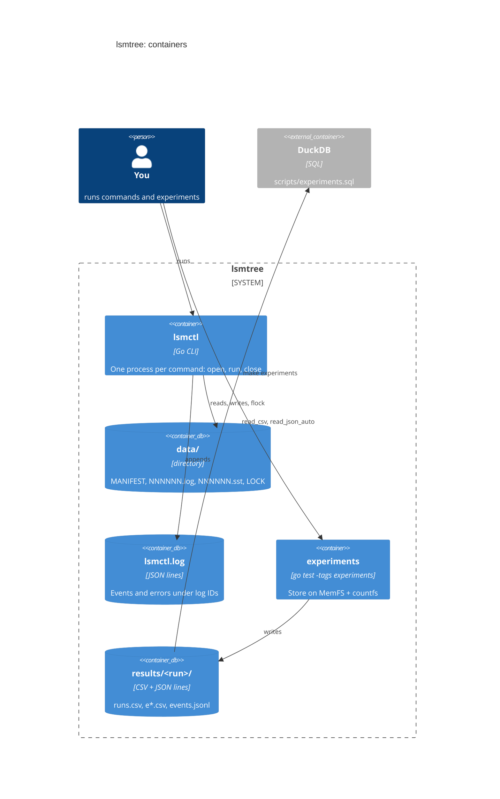
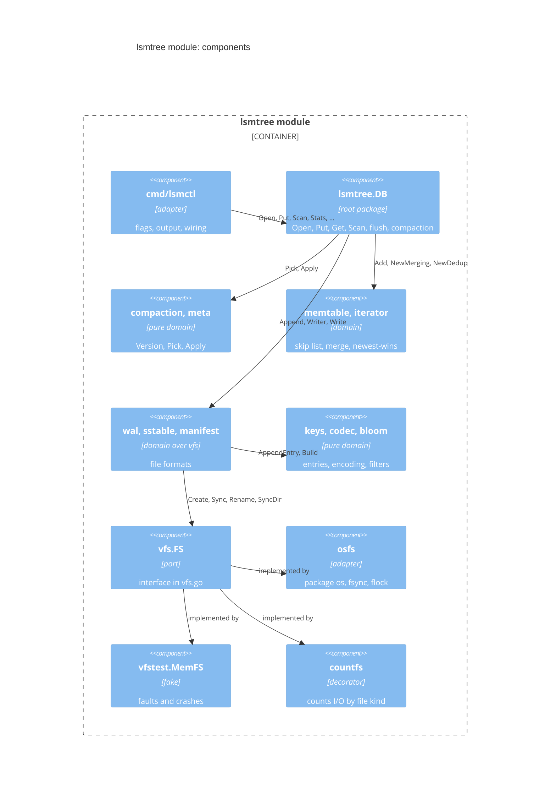
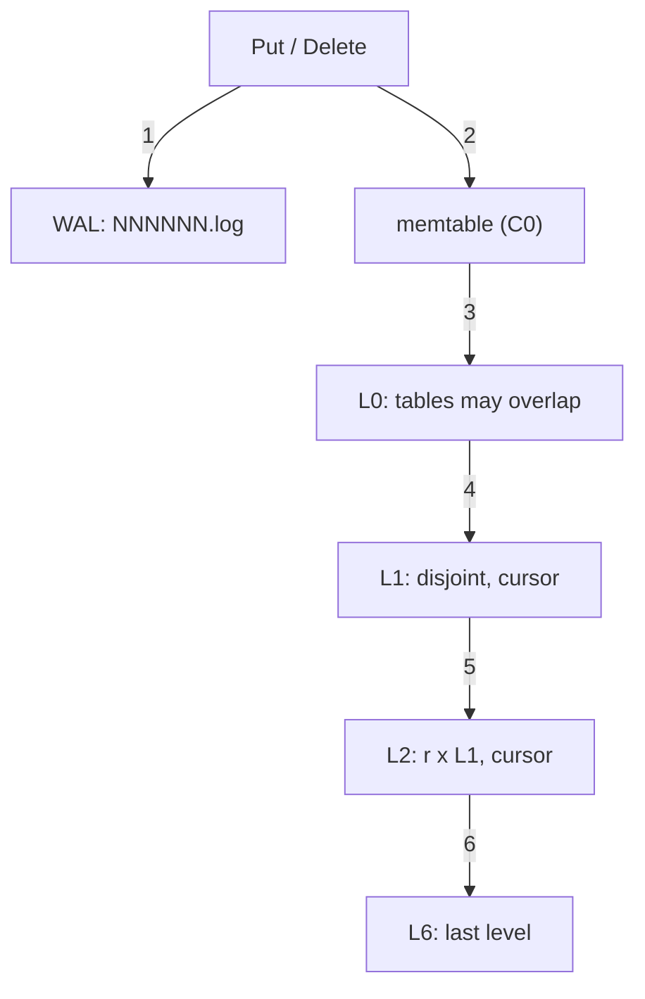
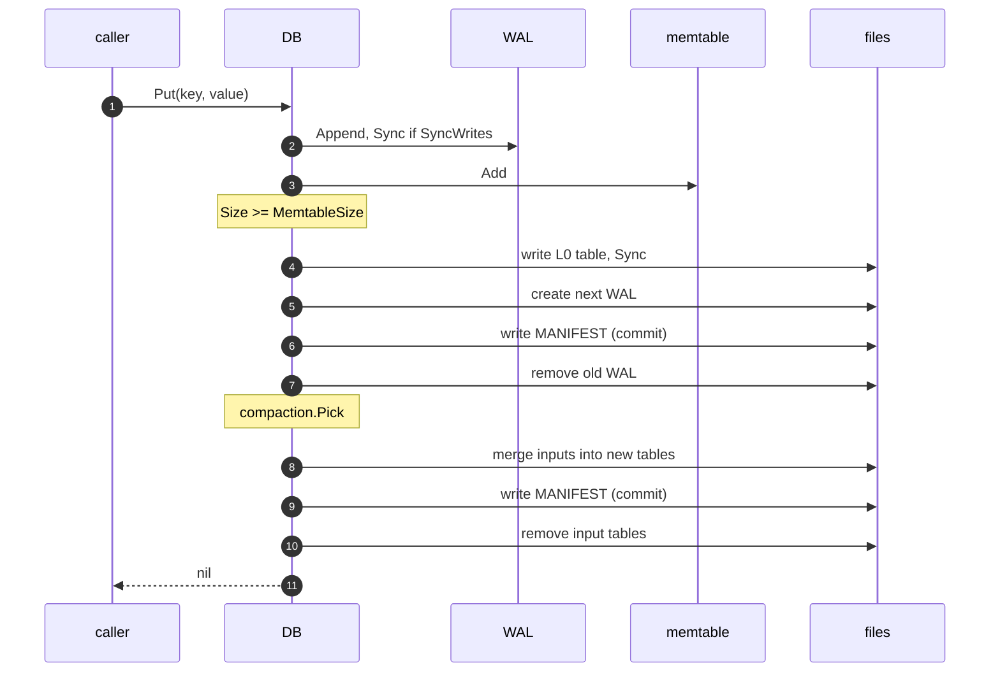

# lsmtree: a code walkthrough

> **Diagrams.** Each diagram appears twice: a Mermaid block that GitHub
> renders, and a Unicode text version for terminals. The text versions are
> generated from the sources in [`diagrams/`](diagrams/). After editing a
> `.mmd` source, regenerate them with
> `python3 ~/.claude/skills/draw-visual/scripts/render.py --update docs/walkthroughs/lsmtree/code.md`.
> The `.mmd` source and the Mermaid block next to it describe the same
> picture, so change them together.

This walks through the non-test code of [`lsmtree/`](../../../lsmtree/),
the project for paper 3, O'Neil, Cheng, Gawlick & O'Neil's *The
Log-Structured Merge-Tree* (1996). The paper's idea in one line: don't
update an index in place; buffer changes in memory, then merge them into
larger sorted runs on disk in big sequential batches.

The tour starts with the filesystem interface, because every durability
rule in the store comes from it. It then climbs through the domain
packages in the order the data meets them (an entry, the memtable, the
log, a table, the merge, the tree's shape, the compaction plan, the
manifest), reaches the `DB` that orchestrates them, and ends with the
`lsmctl` binary and the experiments. The shared helpers from
[`shared/`](../../../shared/) are covered in the
[jumphash walkthrough](../jumphash/code.md#3-aside-sharedassert) and
come up here only where lsmtree uses them differently. The design spec
is [`lsmtree/DESIGN.md`](../../../lsmtree/DESIGN.md); the test side is
in [tests.md](tests.md). Paths below are relative to `lsmtree/` unless
they start with `shared/`, and `file.go:12` means line 12.

## Reading order

| # | Stop | Files | Kind |
|---|------|-------|------|
| 1 | [vfs: the durability model](#1-vfs-the-durability-model) | `internal/vfs/vfs.go`, `internal/osfs/` | port, adapter |
| 2 | [keys and codec: one order, one encoding](#2-keys-and-codec-one-order-one-encoding) | `internal/keys/`, `internal/codec/` | domain |
| 3 | [memtable: C0 as a skip list](#3-memtable-c0-as-a-skip-list) | `internal/memtable/` | domain |
| 4 | [wal: the recovery log](#4-wal-the-recovery-log) | `internal/wal/` | domain, over `vfs` |
| 5 | [bloom: skipping a table](#5-bloom-skipping-a-table) | `internal/bloom/` | domain |
| 6 | [sstable: blocks on disk](#6-sstable-blocks-on-disk) | `internal/sstable/` | domain, over `vfs` |
| 7 | [iterator: the read path and the merge](#7-iterator-the-read-path-and-the-merge) | `internal/iterator/` | domain |
| 8 | [meta: the shape of the tree](#8-meta-the-shape-of-the-tree) | `internal/meta/` | domain |
| 9 | [compaction: the pure planner](#9-compaction-the-pure-planner) | `internal/compaction/` | domain, pure |
| 10 | [manifest: the checkpoint](#10-manifest-the-checkpoint) | `internal/manifest/` | domain, over `vfs` |
| 11 | [The DB: Open and recovery](#11-the-db-open-and-recovery) | `db.go`, `options.go` | orchestration |
| 12 | [The write path and flush](#12-the-write-path-and-flush) | `db.go`, `flush.go` | orchestration |
| 13 | [Compaction: copy, commit, clean up](#13-compaction-copy-commit-clean-up) | `compact.go` | orchestration |
| 14 | [Reads: Get and Scan](#14-reads-get-and-scan) | `db.go` | orchestration |
| 15 | [Failure policy, Stats, and Events](#15-failure-policy-stats-and-events) | `db.go`, `stats.go`, `event.go` | orchestration |
| 16 | [countfs: counting I/O](#16-countfs-counting-io) | `internal/vfs/countfs/` | decorator |
| 17 | [lsmctl and the top level](#17-cmdlsmctl-and-the-top-level) | `cmd/lsmctl/`, `shared/cli/` | binary |
| 18 | [The experiments as consumers](#18-the-experiments-as-consumers) | `experiments/`, `scripts/` | measurement |
| 19 | [End to end](#19-end-to-end) | all of the above | |

## The running system

C4 container view. GitHub renders the Mermaid; the text version below is
for terminals.



<!-- draw-visual: diagrams/code-containers.mmd -->
```text
┌─────────────────┐
│   you (person)  │
└────────┬────────┘
         │
         ├────────────────────────┐
         │                        │
         1                        4
         │                        │
         ▼                        ▼
┌─────────────────┐    ┌─────────────────────┐
│   lsmctl (CLI)  ├──┐ │experiments (go test)├───────5───────┐
└────────┬────────┘  3 └─────────────────────┘               │
         │           │                                       │
         2           └────────────┐                          │
         ▼                        ▼                          ▼
┌─────────────────┐    ┌─────────────────────┐    ┌─────────────────────┐
│data/ (store dir)│    │  lsmctl.log (file)  │    │results/ (CSV, JSONL)│
└─────────────────┘    └─────────────────────┘    └──────────┬──────────┘
                                                             │
┌─────────────────┐                                          │
│      DuckDB     │◄6────────────────────────────────────────┘
└─────────────────┘
```

1. You run `lsmctl`, one process per command. Each run opens the store,
   runs one command, and closes it.
2. The store is one directory: `MANIFEST` (which files are live), one
   `NNNNNN.log` write-ahead log, the `NNNNNN.sst` tables, and `LOCK`,
   which an OS file lock holds while a process has the store open.
3. `lsmctl` appends every flush, compaction, recovery, and error to
   `lsmctl.log`, next to the store directory.
4. `make experiments` runs the `experiments` test package. It opens
   stores on an in-memory filesystem, so it never touches `data/`.
5. Each run writes CSV tables and an `events.jsonl` log to
   `lsmtree/results/<run-id>/`.
6. `scripts/experiments.sql` reads every run with DuckDB and prints the
   blog tables.

There is no server. The library is the root package `lsmtree`;
`lsmctl` is a thin wrapper around it.

## The packages

C4 component view of the `lsmtree` module. The pure domain packages do
no I/O at all. The storage ones (`wal`, `sstable`, `manifest`, and the
`DB`) reach the disk only through the `vfs.FS` port, so tests can run
them on an in-memory filesystem
([coding approach §1](../../coding.md#1-domain-vs-integration)).



<!-- draw-visual: diagrams/code-components.mmd -->
```text
┌──────────────────┐
│    cmd/lsmctl    │
└─────────┬────────┘
          │
          1
          ▼
┌──────────────────┐
│    lsmtree.DB    │
└─────────┬────────┘
          │
          ├───────────────────────┬─────────────────────────┐
          │                       │                         │
          2                       3                         4
          │                       │                         │
          ▼                       ▼                         ▼
┌──────────────────┐    ┌──────────────────┐    ┌──────────────────────┐
│ compaction, meta │    │memtable, iterator│    │wal, sstable, manifest│
└──────────────────┘    └──────────────────┘    └───────────┬──────────┘
                                                            │
          ┌───────────────────────┬─────────────────────────┘
          │                       │
          5                       6
          │                       │
          ▼                       ▼
┌──────────────────┐    ┌──────────────────┐
│keys, codec, bloom│    │  vfs.FS (port)   │
└──────────────────┘    └─────────┬────────┘
                                  │
          ┌───────────────────────┼─────────────────────────┐
          │                       │                         │
          7                       7                         7
          │                       │                         │
          ▼                       ▼                         ▼
┌──────────────────┐    ┌──────────────────┐    ┌──────────────────────┐
│       osfs       │    │  vfstest.MemFS   │    │       countfs        │
└──────────────────┘    └──────────────────┘    └──────────────────────┘
```

1. `lsmctl` calls `lsmtree.Open` and the `DB` methods (adapter).
2. The `DB` asks the pure planner what to compact (`compaction.Pick`)
   and how the tree looks afterwards (`compaction.Apply` on a
   `meta.Version`).
3. Writes go into the memtable; reads and compactions merge sources
   with the `iterator` package.
4. The `DB` writes the WAL, SSTables, and the manifest through their
   packages, which own the file formats.
5. The formats share one entry order (`keys`), one entry encoding and
   CRC (`codec`), and SSTables carry a Bloom filter (`bloom`).
6. Every byte reaches the disk through `vfs.FS`.
7. Three implementations: `osfs` (the real disk), `vfstest.MemFS` (the
   test fake that injects faults and simulates crashes), and `countfs`
   (wraps either one and counts bytes for the experiments).

The `DB` also opens files directly through `vfs.FS` (the lock, the
directory listing at Open, removing obsolete files); the diagram leaves
those edges out, along with the `shared` helpers every package uses.

## The tree

The shape the code builds, from a write down to the last level. This is
an ordinary Mermaid flowchart, not C4, so both forms draw the same graph
(the GitHub block quotes labels that hold parentheses or colons).



<!-- draw-visual: diagrams/code-levels.mmd -->
```text
┌──────────────────────┐
│     Put / Delete     │
└───────────┬──────────┘
            │
            ├──────────────────────┐
            │                      │
            1                      2
            │                      │
            ▼                      ▼
┌──────────────────────┐    ┌─────────────┐
│   WAL: NNNNNN.log    │    │memtable (C0)│
└──────────────────────┘    └──────┬──────┘
                                   │
┌──────────────────────┐           │
│L0: tables may overlap│◄────3─────┘
└───────────┬──────────┘
            │
            4
            ▼
┌──────────────────────┐
│ L1: disjoint, cursor │
└───────────┬──────────┘
            │
            5
            ▼
┌──────────────────────┐
│  L2: r x L1, cursor  │
└───────────┬──────────┘
            │
            6
            ▼
┌──────────────────────┐
│    L6: last level    │
└──────────────────────┘
```

1. Every write is appended to the write-ahead log first.
2. Then it goes into the memtable, the paper's C0.
3. When the memtable passes `MemtableSize`, a flush writes it as one new
   L0 table. L0 tables may overlap each other (a deliberate difference
   from the paper, [DESIGN.md §1](../../../lsmtree/DESIGN.md#1-what-the-paper-says-and-what-we-will-build)).
4. When L0 holds `L0CompactionTrigger` tables, all of L0 is merged into
   the L1 tables it overlaps.
5. When Li is over its byte target, one table, the first after Li's
   rolling-merge cursor, is merged into the Li+1 tables it overlaps.
   This is the paper's rolling merge (stop 9).
6. And so on down. With the default `MaxLevels` of 7 the last level is
   L6. It never compacts, so its size is set by the data: the paper's
   largest component CK.

## 1. vfs: the durability model

[`internal/vfs/vfs.go`](../../../lsmtree/internal/vfs/vfs.go),
[`internal/osfs/osfs.go`](../../../lsmtree/internal/osfs/osfs.go)

The store never calls package `os`. It reaches the disk only through
`vfs.FS` (`vfs.go:34-70`): `Create`, `Open`, `Rename`, `Remove`, `List`,
`MkdirAll`, `SyncDir`, and `Lock`. The package comment states the one
rule every write path in the store follows:

```go
// Two separate things must be synced, as on a real POSIX filesystem:
//
//   - A file's contents are durable only after File.Sync.
//   - A directory entry (a Create, Rename, or Remove) is durable only after
//     SyncDir on its parent directory.
//
// A file that was synced but whose directory entry was not can vanish in a
// crash. The store's write ordering (write, Sync, then rename or SyncDir)
// exists because of this rule.
```
(`vfs.go:10-18`)

`WritableFile` only appends and syncs; `ReadableFile` reads in order or
at offsets and reports its `Size` (`vfs.go:74-93`).

`osfs.FS` is the real adapter, one or two `os` calls per method.
`SyncDir` opens the directory and fsyncs it (`osfs.go:78-88`); `Lock`
takes `flock(2)` with `LOCK_EX|LOCK_NB` and maps `EWOULDBLOCK` to
`vfs.ErrLocked` (`osfs.go:93-106`).

**How it connects to the paper.** The paper assumes a disk that writes
multi-page blocks to new positions and never overwrites what recovery
might need (§2, after Figure 2.2). That only works if you know exactly
when a write is durable. `vfs` makes that explicit, so the crash tests
can check it.

**Things to notice**

- The interface is small on purpose: only the calls the store makes
  ([coding approach §1](../../coding.md#1-domain-vs-integration)).
- The flock belongs to the open file, so a second `Lock` fails even in
  the same process, and the OS releases it when a process dies. That is
  what lets the e2e test reopen a store right after `kill -9`.
- The test fake `vfstest.MemFS` follows the same model and can undo
  anything not yet durable (`Crash`, `CrashTorn`). It is the reason the
  model is written down this precisely; see
  [tests.md](tests.md#4-contract-tests).

## 2. keys and codec: one order, one encoding

[`internal/keys/keys.go`](../../../lsmtree/internal/keys/keys.go),
[`internal/codec/codec.go`](../../../lsmtree/internal/codec/codec.go)

Every write becomes one `keys.Entry`: a user key, a sequence number one
higher than the last write's, a kind, and a value.

```go
type Entry struct {
	Key   []byte
	Seq   uint64
	Kind  Kind
	Value []byte // empty for KindDelete
}

func Compare(a, b Entry) int {
	if c := bytes.Compare(a.Key, b.Key); c != 0 {
		return c
	}
	return cmp.Compare(b.Seq, a.Seq) // reversed: higher seq first
}
```
(`keys.go:52-66`)

- `KindDelete` is a tombstone, `KindPut` a value (`keys.go:32-35`).
- `Validate` (`keys.go:74-88`) states the rules: a key of 1 to
  `MaxKeySize` (4 KiB) bytes, a value of at most `MaxValueSize` (1 MiB),
  a valid kind, no value on a tombstone.
- `Clone` copies both slices; iterators reuse buffers, so anything kept
  is cloned.

`codec` is the one byte encoding of an entry, shared by WAL records and
SSTable data blocks:

```
keylen uvarint | key | seq u64 | kind u8 | vallen uvarint | value
```

`AppendEntry` (`codec.go:52-59`) writes it; `DecodeEntry`
(`codec.go:72-85`) reads it from untrusted bytes and never panics.
`Checksum` is CRC32-C (`codec.go:39`).

**How it connects to the paper.** A tombstone is the paper's *delete
node entry* (§2.3): it sits in a newer component, hides older versions
of the key from finds, and "annihilates" them when a merge reaches them.
The order "key ascending, newest first" is what makes that cheap: the
first version a reader meets is the one that counts.

**Things to notice**

- One order for everything. The memtable, every SSTable, and every
  iterator sort by `keys.Compare` (`keys.go:10-12`).
- Because sequence numbers are unique, no two entries ever compare
  equal. The merging iterator relies on that (stop 7).
- `lenBytes` rejects a uvarint written in a longer form than needed
  (`codec.go:89-96`). So every valid entry has exactly one encoding, and
  `FuzzDecodeEntry` can check that re-encoding gives back the same
  bytes.
- `Validate` returns an error, not an assertion: decoders call it on
  bytes from disk. Writers assert it on entries the store built itself
  ([coding approach §2](../../coding.md#2-validation-vs-contracts)).

## 3. memtable: C0 as a skip list

[`internal/memtable/memtable.go`](../../../lsmtree/internal/memtable/memtable.go)

The memtable holds every version of every key in `keys.Compare` order
until a flush. It is a skip list (Pugh 1990) with p = 1/4 and at most 12
levels.

```go
//	Invariant: level 0 is strictly ordered by keys.Compare and holds
//	           exactly Len() nodes
//	Invariant: every level h > 0 is a subsequence of level h-1, and
//	           holds only nodes whose height is > h
//	Invariant: Size() == Σ (len(key) + len(value) + EntryOverhead)
//	Invariant: every entry's seq is <= maxSeq
type Memtable struct {
	head   node // sentinel; head.next has maxHeight levels
	height int  // levels in use, 1..maxHeight
	rng    *rand.Rand
	n      int
	size   int64
	maxSeq uint64 // highest seq added; meaningless while n == 0
}
```
(`memtable.go:57-70`)

- `Add` (`memtable.go:103-155`) asserts its preconditions: a valid entry,
  and a seq above every seq already added. It copies key and value into
  one allocation, finds the predecessors with `findLess`, and links the
  new node at a random height (`randomHeight`, `memtable.go:205-211`).
- `Get` (`memtable.go:164-170`) returns the newest version of a key,
  tombstone included; the caller decides what a tombstone means.
- `seekGE` probes with `Seq: math.MaxUint64`, which sorts before every
  real version of the key, so it lands on the newest (`memtable.go:197-201`).
- `Size` charges `len(key) + len(value) + EntryOverhead` (100 bytes) per
  entry (`memtable.go:46`). The DB flushes when it passes
  `MemtableSize`.

**How it connects to the paper.** This is C0, the memory-resident
component (§2). Inserting into it costs no I/O. The paper's C0 is an AVL
or 2-3 tree; a skip list gives the same ordered inserts and range walks
and is simpler to check.

**Things to notice**

- Heights come from a PCG generator seeded by the caller
  (`memtable.go:74-82`). The DB seeds it with the next sequence number,
  so the same writes always build the same list, and fuzz failures
  reproduce.
- The memtable owns the "sequence numbers strictly increase" check
  (`memtable.go:108-110`). Since every write goes through `Add`, that is
  where the DB's seq rule is enforced.
- A full invariant walk after every `Add` would make tests O(n²).
  `Add` checks the new node's neighbours every time and walks the whole
  list when `Len` is a power of two or a multiple of 1024
  (`memtable.go:142-154`).
- It keeps every version, not just the newest. Flush deduplicates on
  the way out (stop 12).

## 4. wal: the recovery log

[`internal/wal/wal.go`](../../../lsmtree/internal/wal/wal.go),
[`writer.go`](../../../lsmtree/internal/wal/writer.go),
[`replay.go`](../../../lsmtree/internal/wal/replay.go)

Every write is appended to the log before it goes into the memtable.
There is one log file per memtable. A record is

```
crc u32 | len u32 | payload        (payload = one codec entry)
```

with the CRC over `len` and the payload (`wal.go:8-20`).

`Writer.Append` (`writer.go:53-74`) frames the entry in one buffer and
writes it with a single `Write`. `Sync` (`writer.go:83-92`) fsyncs.
After any failed `Write` or `Sync`, the writer is dead: every later call
returns `ErrFailed` (`writer.go:15-19`).

`Replay` (`replay.go:44-74`) reads records in order and stops at the
first one that is short, fails its CRC, has an impossible length, or
does not decode. That is a torn tail, not an error. It returns a
`Report` of records kept and bytes dropped (`replay.go:22-26`).

```go
// It cannot tell a torn tail from a
// record damaged in the middle of the file (bit rot): both look like a
// bad record. So everything from the first bad record on is dropped,
// even if good records follow it. That keeps the recovered writes a
// prefix of the acknowledged ones, which is what the store relies on: a
// later write is never recovered while an earlier one is lost.
```
(`wal.go:26-31`)

**How it connects to the paper.** §4.2 recovers C0 by replaying "logs
starting with the first LSN after LSN0". Here the manifest (stop 10)
plays the checkpoint: it names the live log (`LogNum`) and the highest
sequence number already in a table (`LastSeq`), and recovery replays
only that log.

**Things to notice**

- The **prefix property** is the store's whole crash guarantee:
  recovered state equals the state after some prefix of the writes
  ([DESIGN.md §3](../../../lsmtree/DESIGN.md#3-public-api-root-package-lsmtree)).
  `FuzzCrashRecovery` checks it end to end.
- A failed fsync is never retried (`writer.go:80-82`). The kernel may
  have dropped the dirty pages, so a retry could report success for
  lost data.
- `readRecord` caps the length it trusts at `codec.MaxEntrySize` and at
  what is left of the file before allocating (`replay.go:86-88`), so a
  corrupt length can't make it allocate gigabytes.
- `Replay` reads with `ReadAt` through a `SectionReader`, so it doesn't
  care where the file's offset is (`replay.go:50`).

## 5. bloom: skipping a table

[`internal/bloom/bloom.go`](../../../lsmtree/internal/bloom/bloom.go)

A Bloom filter over a table's user keys answers "might this table hold
the key?". No means no; yes is wrong with probability about
(1 − e^(−k·n/m))^k.

- `Builder` (`bloom.go:51-54`) keeps one 64-bit hash per key, so the
  SSTable writer can stream entries.
- `Probes` picks k = round(bitsPerKey · ln 2), clamped to 1–30
  (`bloom.go:87-90`). `FalsePositiveRate` is the formula the experiments
  compare against (`bloom.go:99-103`).
- `Build` (`bloom.go:111-125`) sets k bits per key by double hashing:
  probe j is `h1 + j·h2 mod m`. The encoded filter is the bit array
  followed by one byte holding k.
- `MayContain` (`bloom.go:142-159`) accepts any bytes.

```go
func (f Filter) MayContain(key []byte) bool {
	if len(f) < 2 {
		return true
	}
	k := uint64(f[len(f)-1])
	if k < minProbes || k > maxProbes {
		return true
	}
	...
```
(`bloom.go:142-149`)

**How it connects to the paper.** The paper's abstract and §3.4 admit
that finds cost more in an LSM-tree: a lookup may visit every
component. Bloom filters are not in the paper (they are the modern fix);
experiment E4 measures how much of that cost they remove.

**Things to notice**

- The hash is fixed forever: FNV-1a 64 plus a murmur3 finalizer
  (`bloom.go:164-174`). `hash/maphash` is seeded per process, so a
  filter written by one run would give false negatives in the next.
  `TestFilterIsStable` pins it.
- A damaged filter answers "maybe" (`bloom.go:138-141`): it costs a
  block read, never a wrong answer. The table's CRCs catch the damage
  anyway.
- `split` forces h2 odd so it is never zero (`bloom.go:178-180`).
  Plain double hashing still clusters at large k; E4 measures the
  20-bits-per-key rate at about 3.5× the formula
  ([DESIGN.md §8](../../../lsmtree/DESIGN.md#8-experiments-measuring-the-papers-claims)).

## 6. sstable: blocks on disk

[`internal/sstable/format.go`](../../../lsmtree/internal/sstable/format.go),
[`writer.go`](../../../lsmtree/internal/sstable/writer.go),
[`reader.go`](../../../lsmtree/internal/sstable/reader.go),
[`iterator.go`](../../../lsmtree/internal/sstable/iterator.go)

An SSTable is a sorted, immutable file, written once front to back by a
flush or a compaction, then only read.

```
+----------------------+  offset 0
| data block 0         |  entry entry entry ...
| crc u32              |
+----------------------+
| ...                  |
+----------------------+  bloomOff
| bloom filter         |  bloom.Filter bytes; empty if there is no filter
| crc u32              |
+----------------------+  indexOff
| index block          |  one index entry per data block
| crc u32              |
+----------------------+  size - 40
| footer (40 bytes)    |
+----------------------+  size
```
(`format.go:15-31`, shortened)

An index entry is the block's last key, offset, and length. The footer
holds the bloom and index locations, the entry count, its own CRC, and
the magic `"LSM1"` (`format.go:100-109`).

**Writer.** `Add` (`writer.go:85-118`) appends an entry to the open data
block and cuts the block before an entry that would push it past
`BlockSize`. `Finish` (`writer.go:143-199`) writes the last block, the
filter, the index, and the footer, then syncs and closes the file. It
returns a `Summary` (`writer.go:29-35`): the key range, seq range, entry
count, size, and block count that the manifest records.

**Reader.** `Open` (`reader.go:59-106`) reads the footer, the filter, and
the index, keeps them in memory, and checks that the regions tile the
file exactly:

```go
if ft.bloomOff > ft.indexOff || ft.indexOff > footerOff ||
	ft.bloomOff+uint64(ft.bloomLen)+crcSize != ft.indexOff ||
	ft.indexOff+uint64(ft.indexLen)+crcSize != footerOff {
	return nil, fmt.Errorf("%w: footer regions (bloom %d+%d, index %d+%d) do not tile a %d-byte file",
		ErrCorrupt, ft.bloomOff, ft.bloomLen, ft.indexOff, ft.indexLen, size)
}
```
(`reader.go:78-83`)

`Get` (`reader.go:140-161`) asks the filter, then binary-searches the
index for the one block that could hold the key and reads it. The
`tableIter` (`iterator.go`) loads one block at a time and reuses its
buffers.

**How it connects to the paper.** A data block is this project's page,
the unit of I/O the experiments count (the paper's Sp, 4 KiB by
default). A whole table, written sequentially by one merge, plays the
role of the paper's multi-page block: the batch that makes LSM writes
cheap (§3.1).

**Things to notice**

- Every byte is under a CRC: each data block, the filter, the index, and
  the footer (whose CRC covers the entry count). `TestEveryByteFlipIsDetected`
  flips every byte of a table to prove it.
- Data blocks are checked lazily. `readDataBlock` (`reader.go:194-210`)
  verifies the CRC, then `decodeBlock` (`reader.go:216-234`) checks that
  the entries decode, strictly increase, sit above the previous block's
  last key, and end at exactly the key the index promised.
- A bad table is `ErrCorrupt`; a failed read is an I/O error
  (`reader.go:257-267`). The DB turns the first into its own
  `ErrCorrupt`, and the tests check the two never get mixed up.
- `ReaderStats` counts data blocks read and Bloom checks with atomics
  (`reader.go:23-27`). That is where E4's "blocks per Get" comes from.
- The writer's invariant: the bytes written so far end exactly where
  the last indexed block and its CRC end (`writer.go:232-239`).
- `EstimatedSize` (`writer.go:122-133`) lets compaction cut outputs at
  `TableSize` without finishing a table to measure it.

## 7. iterator: the read path and the merge

[`internal/iterator/iterator.go`](../../../lsmtree/internal/iterator/iterator.go),
[`merging.go`](../../../lsmtree/internal/iterator/merging.go),
[`dedup.go`](../../../lsmtree/internal/iterator/dedup.go),
[`slice.go`](../../../lsmtree/internal/iterator/slice.go)

One interface walks sorted entries:

```go
type Iterator interface {
	First()
	SeekGE(key []byte)
	Valid() bool
	Entry() keys.Entry
	Next()
	Err() error
	Close() error
}
```
(`iterator.go:14-45`, comments removed)

The memtable, each SSTable, and two combinators implement it:

- **`NewMerging(children...)`** (`merging.go:39-41`) is a k-way merge. A
  min-heap holds every child that is on an entry, ordered by that
  entry, so the top is the next entry overall. `Next` advances the top
  child and fixes the heap (`merging.go:80-101`).
- **`NewDedup(it, dropTombstones)`** (`dedup.go:45-47`) keeps only the
  newest version of each user key: the first one seen, because
  `keys.Compare` puts the highest seq first. With `dropTombstones` it
  also hides keys whose newest version is a delete.

The read path and the merge are the same stack:
`NewDedup(NewMerging(memtable, tables...), ...)`. `Scan` uses it with
`dropTombstones` true; flush and compaction use it with false.

**How it connects to the paper.** This is the merge step of §2, in
software: entries from the upper component and the lower one come out
in key order, the newer version wins, and the result is written to new
blocks. The same code serves the paper's range find (§2.2), which must
"access each component" and combine them.

**Things to notice**

- `NewDedup`'s doc comment explains *resurrection*
  (`dedup.go:33-38`): dropping a tombstone is safe only when no older
  version can exist below the output. That is why compaction passes
  `plan.Bottom` (stop 13).
- The merge asserts its output strictly increases, and that no two
  children hold the same `(key, seq)` (`merging.go:131-144`). An equal
  pair means sequence numbers were reused: a bug the merge must not
  hide.
- `childHeap.Less` falls back to child order on a tie
  (`merging.go:157-166`), so a broken precondition can't corrupt the
  heap before the assertion reports it.
- The first child error stops the merge and is sticky; `Close` closes
  every child even after one fails (`merging.go:107-116`).
- The per-`Next` checks use `if ... { assert.Fail(...) }` rather than
  `assert.That`, because `That` would box its arguments even when the
  check passes (`merging.go:135-136`).
- `NewSlice` (`slice.go:25-35`) is the simplest iterator; tests use it
  as a source.

## 8. meta: the shape of the tree

[`internal/meta/meta.go`](../../../lsmtree/internal/meta/meta.go)

`meta` describes which tables are live, on which level, plus the
counters for new files and writes. The manifest persists it, the
planner plans over it, and the DB reads through it.

```go
type Version struct {
	Levels      [][]FileMeta // Levels[0] is L0
	NextFileNum uint64       // the next number to hand out for a .sst or .log file
	LastSeq     uint64       // the highest sequence number in any table or the WAL
	LogNum      uint64       // the live WAL: LogName(LogNum)

	// Cursors[i] is the rolling-merge cursor of level i: the largest key
	// of the last file compacted out of it. ...
	Cursors [][]byte
}
```
(`meta.go:45-59`, comment shortened)

`FileMeta` (`meta.go:20-28`) is what the store knows about one table
without opening it: number, size, key range, seq range, entry count.

The invariant (`meta.go:37-44`), checked by `Validate`
(`meta.go:105-144`):

- L0 tables are ordered by file number and may overlap.
- In L1 and below, tables are sorted by smallest key and never overlap.
- Every file number is below `NextFileNum`, and so is `LogNum`.
- Every table's `MaxSeq` is at most `LastSeq`.
- No file number appears twice; there are no more cursors than levels.

`TableName` and `LogName` (`meta.go:171-175`) give `000012.sst` and
`000012.log`; `ParseFileName` (`meta.go:184-199`) is their inverse, used
to classify files at Open and in `countfs`.

**How it connects to the paper.** A `Version` is the paper's "disk
addresses of the roots of all components" plus "the location of all
merge cursors" (§4.2): everything a reader or a restart needs to find
the data.

**Things to notice**

- `Validate` returns an error; `CheckInvariant` asserts it
  (`meta.go:148-154`). Same check, two uses: a bad `Version` read from
  disk is corrupt input, a bad one built in memory is a bug.
- `AddL0` and `Clone` return new values (`meta.go:64-88`). A `Version`
  is never changed in place, so the DB can build the next one, try to
  commit it, and keep the old one if that fails.
- Because L1+ tables are disjoint, a point lookup reads at most one
  table per level (stop 14).

## 9. compaction: the pure planner

[`internal/compaction/compaction.go`](../../../lsmtree/internal/compaction/compaction.go)

`compaction` decides what to merge next. A `Version` and the options go
in; a `Plan` comes out. It reads no files, so every rule is tested with
plain structs. It is this project's version of jumphash's `PlanMoves`.

```go
type Plan struct {
	Level    int             // the level being compacted; outputs go to Level+1
	Inputs   []meta.FileMeta // files from Level: all of L0, or one file from Li
	Overlaps []meta.FileMeta // files from Level+1 that overlap Inputs' key range
	Bottom bool   // no deeper level holds any key in the merge's range
	Cursor []byte // the new rolling-merge cursor for Level; nil for L0
}
```
(`compaction.go:71-83`, comments shortened)

- `Pick` (`compaction.go:106-130`) scores every level but the last
  (`pickLevel`, `compaction.go:134-152`): L0 by file count over
  `L0Trigger`, Li by bytes over `LevelTargets[i]`. A level needs
  compacting at a score of 1 for L0 and above 1 for Li. The highest
  score wins; a tie goes to the shallower level.
- For L0 it takes every L0 table. For Li it takes one table:
  `NextInput(files, cursor)`.
- `plan` (`compaction.go:173-188`) adds every Li+1 table that overlaps
  the inputs, then sets `Bottom` if nothing deeper overlaps the widened
  range.
- `Apply` (`compaction.go:296-313`) returns the next `Version`: inputs
  and overlaps gone, outputs on Li+1 in key order, and Li's cursor moved
  to `p.Cursor`.

The rolling-merge rule itself is five lines:

```go
func NextInput(files []meta.FileMeta, cursor []byte) int {
	for i, f := range files {
		if bytes.Compare(f.Smallest, cursor) > 0 {
			return i
		}
	}
	return 0
}
```
(`compaction.go:163-170`)

**How it connects to the paper.** §2 pictures the merge between C*i*
and C*i+1* as "a conceptual cursor which slowly circulates in quantized
steps through equal key values", taking the next multi-page block of
the smaller component, merging it into the matching leaves of the
larger, and starting "again from the smallest values" when it reaches
the end (Figure 2.2). Here each level ≥ 1 has a cursor, the largest key
of the last table compacted out of it. `NextInput` takes the first table
after it and wraps to the first, so over many compactions the cursor
sweeps the whole level. The paper's quantum is a block; ours is a table.

Theorem 3.1 says that, for a fixed largest component and memory
component, total merge I/O is lowest when every ratio
r*i* = S*i*/S*i−1* is the same. `Options.LevelTargets` holds the sizes;
the DB fills them geometrically, `BaseLevelSize · r^(i−1)`
(`options.go:96-107`), unless a caller passes explicit targets, which
is how experiment E3 breaks the rule on purpose to test it.

**Things to notice**

- The cursor lives in the `Version` (`meta.go:51-58`), so the manifest
  write that commits a compaction's files also commits its cursor. A
  restarted store resumes the sweep where it stopped, as the paper's
  checkpoint does (`compaction.go:19-21`).
- `Bottom` is what makes tombstone garbage collection safe: a delete is
  dropped only when no deeper table could hold an older version of its
  key (§2.3's "annihilates the associated entry").
- `checkPlan` (`compaction.go:218-258`) re-derives the overlaps and the
  bottom flag by brute force, with its own `meets` instead of
  `FileMeta.Overlaps`, "so a bug in one is not hidden by the same bug in
  the other" (`compaction.go:215-217`).
- The last level never compacts (`compaction.go:98-100`). It is CK,
  sized by the data.
- A level exactly at its target does not compact (`size > target`,
  `compaction.go:145`), so `Compact` can stop there.
- `NextInput` is exported so `Stats` marks the next table with the
  planner's own rule (stop 15), not a copy of it.

## 10. manifest: the checkpoint

[`internal/manifest/manifest.go`](../../../lsmtree/internal/manifest/manifest.go)

The manifest persists a `Version`. The file is one line of compact JSON
and a checksum line:

```
{"nextFileNum":4,"lastSeq":17,"logNum":3,"levels":[[],[{"num":2,"size":4096,"smallest":"6170706c65","largest":"70656172",...}]],"cursors":["","70656172"]}
crc32c 1a2b3c4d
```
(`manifest.go:11-12`)

- `Encode` (`manifest.go:125-142`) asserts the `Version` invariant,
  marshals the on-disk shapes `fileJSON` and `versionJSON`
  (`manifest.go:81-97`), and appends the CRC line.
- `Decode` (`manifest.go:154-205`) treats the bytes as untrusted: it
  checks the trailer and CRC, refuses unknown fields and trailing data,
  decodes hex keys, and runs `Version.Validate`. Every problem wraps
  `ErrCorrupt`.
- `Write` (`manifest.go:217-229`) replaces the file atomically. Each
  step's error says what state it left:

```go
tmp := filepath.Join(dir, TmpName)
if err := writeSynced(fsys, tmp, Encode(v)); err != nil {
	return fmt.Errorf("manifest: old manifest unchanged: %w", err)
}
if err := fsys.Rename(tmp, filepath.Join(dir, FileName)); err != nil {
	return fmt.Errorf("manifest: old manifest unchanged: rename %s: %w", tmp, err)
}
if err := fsys.SyncDir(dir); err != nil {
	return fmt.Errorf("manifest: sync dir %s: new manifest in place but may not survive a crash: %w", dir, err)
}
```
(`manifest.go:218-228`)

**How it connects to the paper.** §4.2's checkpoint records the last
LSN, "the disk addresses of the roots of all components", and "the
location of all merge cursors". The manifest records `LastSeq` and
`LogNum`, every live table per level, and `Cursors`. Recovery starts
from it and replays only the log it names, as the paper replays logs
after LSN0.

**Things to notice**

- The last error is the important one: if only the directory sync
  fails, the new manifest is in place but may not survive a crash. The
  outcome is **unknown**, and the caller must not act as if the commit
  failed. Stop 13 tells the story of the bug this caused.
- Keys are lowercase hex (`manifest.go:25-30`): JSON strings must be
  UTF-8, and hex has one spelling per byte string.
- Compact JSON, not indented: indenting cost about 45% of the CPU in the
  experiments ([DESIGN.md §5](../../../lsmtree/DESIGN.md#5-on-disk-formats)).
  `head -n 1 MANIFEST | jq .` still pretty-prints it.
- Rewriting the whole file is O(live files) per change. LevelDB appends
  version edits instead; the doc comment says why this project doesn't
  (`manifest.go:39-43`).
- A manifest written before cursors existed has no `cursors` field and
  reads back with none (`manifest.go:19-23`).

## 11. The DB: Open and recovery

[`db.go`](../../../lsmtree/db.go),
[`options.go`](../../../lsmtree/options.go)

```go
type DB struct {
	mu   sync.Mutex
	dir  string
	fs   vfs.FS
	opts Options
	lock io.Closer

	v      meta.Version               // the live files; mirrors the manifest on disk
	tables map[uint64]*sstable.Reader // an open reader for every file in v
	mem    *memtable.Memtable
	log    *wal.Writer // the WAL for mem, file v.LogNum

	failed  error // set when a write path fails; see "Failures" above
	closed  bool
	stats   Stats
	retired sstable.ReaderStats // read counters of readers already closed
}
```
(`db.go:68-84`)

`Open` (`db.go:89-100`) fills option defaults (`Options.withDefaults`,
`options.go:68-115`: 64 KiB memtable, 4 KiB blocks, 10 Bloom bits per
key, L0 trigger 4, L1 = 256 KiB, ratio 10, 7 levels, 64 KiB tables) and
calls `open` (`db.go:102-140`):

1. `MkdirAll`, then `Lock("LOCK")`. A held lock becomes "another
   process is using it".
2. `manifest.Read`. A missing manifest is a new store
   (`NextFileNum: 1`); a corrupt one is `ErrCorrupt`.
3. Pad `Levels` to `MaxLevels`, and open a reader for every live table.
4. `recover` (`db.go:145-181`): replay the WAL named by `LogNum` into a
   fresh memtable, flush it to an L0 table (which also starts a new
   WAL), delete every file the manifest doesn't name
   (`removeObsolete`, `flush.go:185-212`), and emit an
   `EventRecovery`.

```go
report, err = wal.Replay(f, func(e keys.Entry) error {
	if e.Seq <= db.v.LastSeq {
		return fmt.Errorf("%w: WAL record seq %d is not above the manifest's last seq %d", ErrCorrupt, e.Seq, db.v.LastSeq)
	}
	db.mem.Add(e)
	db.v.LastSeq = e.Seq
	return nil
})
```
(`db.go:158-165`)

**How it connects to the paper.** This is §4.2's restart: locate the
checkpoint, reload the components it names, then read the logs after
LSN0 and insert their entries into C0.

**Things to notice**

- Recovery always ends with a flush, so the WAL is only ever created
  and appended to, never reopened for writing (`db.go:142-144`).
- The flush at Open does **not** compact. A store reopened many times
  can sit with L0 over its trigger until the next write fills the
  memtable or someone calls `Flush` or `Compact` (stop 12).
- A WAL the manifest names but that doesn't exist is treated as empty
  (`db.go:152-154`): it was created but its directory entry never became
  durable, so nothing in it was acknowledged with `SyncWrites`.
- `removeObsolete` is the clean-up half of every write path: tables
  from a compaction that never committed, WALs already flushed, and a
  stray `MANIFEST.tmp`. It is safe only at Open, when nothing can be
  using them.
- `Options` uses `0` for "the default" (`options.go:11-13`) and
  `NoBloom` to turn filters off, because 0 Bloom bits would otherwise
  mean the default 10.

## 12. The write path and flush

[`db.go`](../../../lsmtree/db.go),
[`flush.go`](../../../lsmtree/flush.go)

`Put` and `Delete` both call `write` (`db.go:193-230`):

```go
e := keys.Entry{Key: key, Seq: db.v.LastSeq + 1, Kind: kind, Value: value}
if err := db.log.Append(e); err != nil {
	return db.fail(err, "cannot %s %q: the WAL write failed, so the write is lost", kind, key)
}
if db.opts.SyncWrites {
	if err := db.log.Sync(); err != nil {
		return db.fail(err, "cannot %s %q: the WAL sync failed, so the write may be lost", kind, key)
	}
}
db.mem.Add(e)
db.v.LastSeq = e.Seq
```
(`db.go:206-216`)

Key and value sizes are validated before the lock, at the API edge
(`db.go:194-199`). Once the memtable passes `MemtableSize`, the same call
runs `flush` and then `compact` (`db.go:220-229`).

`flush` (`flush.go:29-88`) follows copy, commit, clean up:

1. **Copy.** Write the memtable through
   `NewDedup(mem.NewIterator(), false)` into one L0 table, synced by
   `Writer.Finish`. Create the next WAL.
2. **Commit.** `manifest.Write` a `Version` that lists the table
   (`AddL0`) and names the new WAL.
3. **Clean up.** Switch to the new WAL and a fresh memtable, open a
   reader for the table, and remove the old WAL.

`writeTable` (`flush.go:106-169`) drains any iterator into new tables,
numbered from `NextFileNum`, cutting a new table at `splitAt` bytes
(compaction's `TableSize`; 0 means one table, as in a flush). On error
it removes what it wrote: nothing references those files yet.

**How it connects to the paper.** The paper merges C0 straight into C1.
This store adds L0: a flush writes one table sequentially and reads
nothing, and merging happens separately. That keeps flush and merge
independently testable ([DESIGN.md §1](../../../lsmtree/DESIGN.md#1-what-the-paper-says-and-what-we-will-build)).

**Things to notice**

- WAL first, then memtable. A write the WAL refused never reaches the
  memtable, so a reader can't see a write a crash would lose.
- Without `SyncWrites`, a crash can lose a suffix of recent writes,
  never an older one while keeping a newer one. `Close` syncs the WAL,
  so a clean close loses nothing (`db.go:421-441`).
- The flush's new table and new WAL become durable directory entries
  through the manifest's own `SyncDir`: they live in the same directory
  and were created before the rename.
- If the manifest write fails, `flush` keeps the table and both WALs
  (`flush.go:53-58`). The outcome is unknown; Open sorts out which files
  the surviving manifest names.
- `Flush` skips an empty flush but always compacts (`db.go:354-365`),
  because the flush at Open never compacts. `TestCompactAfterReopen`
  pins that, and the e2e `TestCompactShrinksL0` exercises it through
  separate processes, where each `lsmctl put` leaves one small L0 table.
- `Compact` is `Flush` (`db.go:372-374`): every flush already compacts
  until each level is within its target. It does not merge everything
  into the last level.

## 13. Compaction: copy, commit, clean up

[`compact.go`](../../../lsmtree/compact.go)

`compact` (`compact.go:17-27`) asks the planner for a plan and runs it,
until `Pick` says no level needs one. `runCompaction`
(`compact.go:34-95`) is one step of the rolling merge:

1. **Copy.** Open an iterator on every input and overlap, merge them
   with `NewDedup(NewMerging(...), false)`, and write the result with
   `writeTable(..., plan.Bottom, TableSize)`, which drops tombstones only
   when the plan is at the bottom.
2. **Commit.** `compaction.Apply` builds the next `Version`, and
   `manifest.Write` commits it, cursor included.
3. **Clean up.** Open readers for the outputs, then retire and delete
   every input (`retireTable`, `compact.go:99-104`, keeps the closed
   readers' counters in the totals).

**The ambiguous commit.** The commit step reads:

```go
next = compaction.Apply(next, plan, out.files)
if err := manifest.Write(db.fs, db.dir, next); err != nil {
	// Don't remove the outputs: if only the final directory sync
	// failed, the new manifest is already in place and names them.
	// The outcome is unknown, so leave every file; Open deletes the
	// ones the surviving manifest doesn't list.
	return fmt.Errorf("cannot record the compaction of L%d in the manifest: %w", plan.Level, err)
}
```
(`compact.go:59-66`)

The first version of compaction deleted its outputs on *any* manifest
error. When only the final `SyncDir` failed, the new manifest was
already in place, so the store pointed at tables that had just been
deleted. The fault-injection sweep `TestEveryFaultLeavesARecoverableStore`
found it ([DESIGN.md §5](../../../lsmtree/DESIGN.md#5-on-disk-formats)).
The fix is to treat a failed commit as "old or new, unknown": leave
every file, stop taking writes, and let Open's `removeObsolete` delete
whichever files the surviving manifest doesn't name.

**How it connects to the paper.** The paper writes merged blocks "to new
disk positions, so that the old blocks will not be overwritten and will
be available for recovery in case of a crash", and invalidates the old
ones only after the merge step completes (§2). Copy, commit, clean up is
the same rule with files: the inputs stay on disk until the manifest no
longer names them.

**Things to notice**

- `bytesRead`, `entriesIn`, and `newEntries` come from the inputs'
  `FileMeta`, because the merge reads every input in full
  (`compact.go:39-52`). The upper input's entries divided by the output
  blocks is the paper's batch-merge parameter M (Definition 3.2.1),
  which experiment E1 measures from the `Event`.
- An L0 compaction takes every L0 table, so its overlap range is wide
  and it rewrites much of L1. A deeper compaction takes one table and
  usually rewrites a few tables below. That difference is why E2 and E3
  report per-level costs.
- There is no "trivial move": a table that overlaps nothing below is
  still rewritten. E2's sequential-key run shows the cost (about one
  copy per level).
- The `DB` invariant is checked after every flush and compaction:
  every live table has an open reader, and nothing else does
  (`db.go:544-557`).

## 14. Reads: Get and Scan

[`db.go`](../../../lsmtree/db.go)

`Get` (`db.go:234-256`) checks the memtable, then the tables
(`getFromTables`, `db.go:261-293`). The first version found is the
newest, because every level holds only data older than the level above:

```go
l0 := db.v.Levels[0]
for i := len(l0) - 1; i >= 0; i-- {
	if !l0[i].Overlaps(key, key) {
		continue
	}
	if e, found, err := probe(l0[i]); found || err != nil {
		return e, found, err
	}
}
for _, files := range db.v.Levels[1:] {
	i, _ := slices.BinarySearchFunc(files, key, func(f meta.FileMeta, k []byte) int {
		return bytes.Compare(f.Largest, k)
	})
	...
```
(`db.go:270-284`, shortened)

A tombstone found anywhere ends the search with "absent"
(`db.go:252-254`). The returned value is a copy.

`Scan` (`db.go:301-344`) picks the tables whose range meets
`[start, end)`, stacks `NewDedup(NewMerging(memtable, tables...), true)`,
and calls `fn` for each live key in order, stopping at `end` or when `fn`
returns false.

**How it connects to the paper.** §2.2: "first the C0 tree and then the
C1 tree is searched", and with more components "it is necessary for an
exact-match find or range find to access each component". A Get stops
at the first component that has the key; a Scan merges all of them.

**Things to notice**

- A missing key is `ok == false`, not an error. An early draft returned
  `ErrNotFound`, but a well-formed error captures a stack trace, which
  made every miss expensive and distorted the read experiments
  ([DESIGN.md §3](../../../lsmtree/DESIGN.md#3-public-api-root-package-lsmtree)).
- L0 is searched newest first because its tables may overlap. In L1+
  binary search finds the one table whose range could hold the key.
- `TablesProbed` counts every table a Get asks (`db.go:267`); each probe
  costs one Bloom check if filters are on.
- `Scan` holds the lock for the whole walk, so `fn` must not call the DB
  (`db.go:299-300`).
- `reader` (`db.go:533-541`) reopens a table whose reader is missing, so
  reads recover as soon as the filesystem does after a failed
  post-commit open.

## 15. Failure policy, Stats, and Events

[`db.go`](../../../lsmtree/db.go),
[`stats.go`](../../../lsmtree/stats.go),
[`event.go`](../../../lsmtree/event.go)

**Failures.** If the WAL write, a flush, or a compaction fails, `fail`
(`db.go:483-487`) records the error, and from then on `writable`
(`db.go:470-479`) refuses every write with `ErrWritesFailed` wrapping
the first failure. Reads keep working. Reopening recovers every
acknowledged write. The reason: after a failed step the in-memory state
may disagree with the disk, and retrying in place is how stores lose
data. Reopening rebuilds the state from the manifest and WAL, the only
sources of truth.

Every public error is an `*errs.Error` from module `"lsmtree"`
(`db.go:51-65`), and its message says whether anything changed:
"nothing changed", "the write may be lost", "the database takes no more
writes until it is reopened". `tableErr` (`db.go:491-496`) turns
`sstable.ErrCorrupt` into the DB's `ErrCorrupt`, so callers need only
one sentinel.

**Stats.** `Stats()` (`stats.go:76-109`) returns counters since Open
(writes, flush and compaction bytes, Gets, tables probed, blocks read,
Bloom checks) and the shape of the tree: per level, its tables, bytes,
target, rolling-merge cursor, and `Next`, the index of the table the
level's next compaction will take, computed with
`compaction.NextInput` (`stats.go:93-95`). `WriteAmplification` is table
bytes written over user bytes written (`stats.go:68-73`).

**Events.** `Options.Events` is called after each flush, compaction,
and recovery (`db.go:498-502`). An `Event` (`event.go:17-42`) is flat and
JSON-tagged: levels from and to, files and bytes in and out, entries in
and out, tombstones dropped, `NewEntries` and `OutputBlocks` for M, and
for recovery the WAL records kept and bytes dropped.

**Things to notice**

- The store reports; the caller decides whether to log
  ([coding approach §4](../../coding.md#4-logging)). `lsmctl` logs
  events to `lsmctl.log`; the experiments write them to
  `events.jsonl`.
- `Events` runs with the DB lock held and must not call back into the
  DB (`options.go:60-63`).
- One mutex guards everything, and flushes and compactions run inside
  the write that triggers them (`db.go:12-17`). That makes every run
  deterministic, which `FuzzDBModel` needs. The paper's §4.1
  concurrency (merges running while finds continue) is DESIGN's
  optional milestone 7.

## 16. countfs: counting I/O

[`internal/vfs/countfs/countfs.go`](../../../lsmtree/internal/vfs/countfs/countfs.go)

`countfs.FS` wraps any `vfs.FS` and counts bytes, calls, and syncs per
file kind, classified by name with `meta.ParseFileName` and
`manifest.FileName` (`KindOf`, `countfs.go:31-45`): `wal`, `table`,
`manifest`, or `other`. `Snapshot` returns the counts, `Reset` zeroes
them (`countfs.go:74-87`).

```go
func (w *writable) Write(p []byte) (int, error) {
	n, err := w.WritableFile.Write(p)
	w.fs.add(w.kind, func(c *Counts) { c.Writes++; c.BytesWritten += int64(n) })
	return n, err
}
```
(`countfs.go:144-148`)

**How it connects to the paper.** The paper argues in pages and
multi-page blocks, not seconds. Counting bytes through the filesystem
port tests the argument in its own units, and the result is the same on
every machine ([DESIGN.md §8](../../../lsmtree/DESIGN.md#8-experiments-measuring-the-papers-claims)).

**Things to notice**

- It is a decorator: the store doesn't know it is being measured.
  `countfs_test.go` runs the FS contract against it to prove it changes
  no behaviour.
- E2 checks that `countfs`'s table bytes agree with `Stats`, and uses
  its WAL and manifest counts, which `Stats` doesn't track (the
  manifest turns out to cost more than the WAL).

## 17. `cmd/lsmctl` and the top level

[`cmd/lsmctl/main.go`](../../../lsmtree/cmd/lsmctl/main.go),
[`commands.go`](../../../lsmtree/cmd/lsmctl/commands.go),
[`print.go`](../../../lsmtree/cmd/lsmctl/print.go),
[`shared/cli/cli.go`](../../../shared/cli/cli.go)

`lsmctl [flags] <command>` runs one command against the store in `-dir`
(default `data`). The commands are `put`, `get`, `del`, `scan`, `load`,
`flush`, `compact`, `stats`, `dump`, and `verify` (`main.go:36-73`).
Tuning flags (`-memtable`, `-block`, `-table`, `-bloom`, `-no-bloom`,
`-l0-trigger`, `-base`, `-ratio`) set `lsmtree.Options` for that run
only; sizes take `k`, `m`, or `g` (`parseSize`, `main.go:170-191`).

`realMain` (`main.go:95-139`) is the top level, the same pattern as
`kvctl` (see the [jumphash walkthrough](../jumphash/code.md#14-cmdkvctl-and-the-top-level)):

```go
logger, closeLog := cli.OpenLog(*logPath, stderr)
defer closeLog()
c.logger = logger.With("command", fs.Arg(0), "args", fs.Args()[1:], "dir", c.dir)
r := cli.Reporter{Logger: c.logger, Stderr: stderr, LogPath: *logPath, Modules: []string{lsmtree.Module, module}}

defer r.Recover(&code)
```
(`main.go:124-131`)

An error whose outermost module is `lsmtree` or `lsmctl` is a known
edge case: one line and a log ID, exit 1. Anything else, including a
failed assertion, is reported as a bug, exit 70.

- `run` (`commands.go:33-159`) picks each command's arity and work, then
  `withDB` (`commands.go:163-177`) opens the store, runs it, and closes
  it. Every run is a full open and close, so the WAL replay and
  recovery run every time.
- `event` (`commands.go:181-200`) logs every flush, compaction, and
  recovery to `lsmctl.log`, and with `-v` prints them.
- `load <n>` (`commands.go:206-257`) writes `key-00000000` …, shuffled
  by `-seed`, with values from `loadValue` (`commands.go:265-271`). With
  `-sync`, it prints each key as soon as `Put` returns: the list of
  acknowledged writes the SIGKILL test checks.
- `dump` (`print.go:108-150`) prints each level's tables and key ranges,
  the cursor, and `->` on `Stats.Levels[i].Next`.

**Things to notice**

- `stats` scans the whole store on purpose to count live keys
  (`commands.go:112-115`), because `Stats` knows table sizes but not how
  much of them is overwritten or deleted data.
- Ctrl-C cancels the context, which stops `load` between writes; the
  store is then closed cleanly (`main.go:87-91`, `commands.go:239-241`).
- `show` (`commands.go:293-301`) quotes keys that are empty, start with
  a quote, or hold unprintable bytes, so `scan` output stays one line per
  key.
- `runCommand` is a package variable (`main.go:142`), the test seam
  `TestPanicIsReportedAsBug` uses.

## 18. The experiments as consumers

[`experiments/`](../../../lsmtree/experiments/),
[`scripts/experiments.sql`](../../../lsmtree/scripts/experiments.sql),
and the shared [`experiment`](../../../shared/experiment/) package and
[runner](../../../shared/scripts/experiments.sh)

The experiments are test files (build tag `experiments`), but they read
best as the store's second client after `lsmctl`. Each opens stores on
`countfs.New(vfstest.NewMemFS())`, sets `Options.Events` to an event
log, loads data, and compares counts with the paper's formulas
(`openDB`, `experiments/helpers_test.go:92-106`).

| Test | Paper claim | What it uses from the store |
|------|-------------|-----------------------------|
| `TestE1BatchMerge` | M = (Sp/Se)·S0/(S0+S1), formula 3.2 | `Event.NewEntries / OutputBlocks` of the L0→L1 compaction |
| `TestE2WriteAmp` | write amplification grows with r (§3.3, formulas 3.6–3.7) | `Stats`, per-level `Event` bytes, `countfs` WAL and manifest bytes |
| `TestE3Theorem31` | equal ratios minimise merge I/O (Theorem 3.1) | explicit `LevelTargets`, compaction bytes read and written |
| `TestE4ReadAmp` | finds cost more (abstract, §3.4) | `Stats.TablesProbed`, `BlocksRead`, `BloomChecks`, `BloomNegatives` |

The plumbing is not lsmtree's own: `shared/experiment` provides the
tables (`experiment.Table`, printed with `t.Log` and saved as CSV), the
parallel `experiment.Sweep` over configurations, the run directory with
its `runs.csv`, and JSON-lines logs. `TestMain` is one line,
`os.Exit(experiment.Main(m))`, and the event log's `hook` writes each
`Event`, tagged with experiment, config, and phase, to
`experiment.Current().Log("events.jsonl")`. `make experiments` runs
`../shared/scripts/experiments.sh .`, which makes
`results/<run-id>/`, sets `EXPERIMENT_RESULTS_DIR` and friends, runs the
suite (`make experiments-lsmtree RUN=E3` from the root passes a `-run`
pattern), and, if `duckdb` is installed, runs `experiments.sql` over
`results/*/`, showing each experiment from the latest run that measured
it. Its views are one line each, `FROM latest('e3_theorem31')`, using
the macros in the shared
[`experiments_prelude.sql`](../../../shared/scripts/experiments_prelude.sql);
the events table reads `events.jsonl` only from the runs in the
prelude's `latest_runs`, keeping each experiment's own events. The results and what they show are in
[DESIGN.md §8](../../../lsmtree/DESIGN.md#8-experiments-measuring-the-papers-claims).

**Things to notice**

- Every number is a count, so every run gives the same numbers on every
  machine. Each test asserts a loose expected shape, which makes the
  suite a regression check as well as a measurement.
- E1 and E3 set `L0CompactionTrigger` to 1, so each flush is merged
  into L1 at once; that turns this store's flush-then-merge into the
  paper's C0→C1 merge, plus one extra sequential read of L0 that the
  tests subtract.
- `Options.LevelTargets` exists for E3: it lets the experiment pick S1
  freely instead of `BaseLevelSize · r^(i−1)`.

## 19. End to end

### A Put that triggers a flush and a compaction

What happens when `db.Put` fills the memtable and L0 is one table short
of its trigger. The sequence diagram is the same in both forms.



<!-- draw-visual: diagrams/code-write-path.mmd -->
```text
┌────────┐     ┌────┐     ┌─────┐     ┌──────────┐     ┌───────┐
│ caller │     │ DB │     │ WAL │     │ memtable │     │ files │
└────┬───┘     └──┬─┘     └──┬──┘     └─────┬────┘     └───┬───┘
     │            │          │              │              │
     │ 1. Put(key, value)    │              │              │
     ├───────────►│          │              │              │
     │            │          │              │              │
     │            │ 2. Append, Sync if SyncWrites          │
     │            ├─────────►│              │              │
     │            │          │              │              │
     │            │ 3. Add   │              │              │
     │            ├────────────────────────►│              │
     │            │          │              │              │
     │ ┌──────────────────────┐             │              │
     │ │ Size >= MemtableSize │             │              │
     │ └──────────────────────┘             │              │
     │            │          │              │              │
     │            │ 4. write L0 table, Sync │              │
     │            ├───────────────────────────────────────►│
     │            │          │              │              │
     │            │ 5. create next WAL      │              │
     │            ├───────────────────────────────────────►│
     │            │          │              │              │
     │            │ 6. write MANIFEST (commit)             │
     │            ├───────────────────────────────────────►│
     │            │          │              │              │
     │            │ 7. remove old WAL       │              │
     │            ├───────────────────────────────────────►│
     │            │          │              │              │
     │   ┌─────────────────┐ │              │              │
     │   │ compaction.Pick │ │              │              │
     │   └─────────────────┘ │              │              │
     │            │          │              │              │
     │            │ 8. merge inputs into new tables        │
     │            ├───────────────────────────────────────►│
     │            │          │              │              │
     │            │ 9. write MANIFEST (commit)             │
     │            ├───────────────────────────────────────►│
     │            │          │              │              │
     │            │ 10. remove input tables │              │
     │            ├───────────────────────────────────────►│
     │            │          │              │              │
     │ 11. nil    │          │              │              │
     │◄┈┈┈┈┈┈┈┈┈┈┈┤          │              │              │
     │            │          │              │              │
```

Step by step, with the code each step runs:

1. **Validate and lock** (`db.go:194-204`). A bad key or value returns
   an error that says nothing changed. A failed or closed DB refuses.
2. **Log** (`db.go:206-214`). The entry gets seq `LastSeq + 1` and is
   appended to the WAL, and synced if `SyncWrites`.
3. **Memtable** (`db.go:215-218`). `mem.Add`; `LastSeq` advances.
4. **Flush: copy** (`flush.go:33-40`). The memtable, deduplicated, goes
   into table `NextFileNum`; `Finish` syncs it.
5. **New WAL** (`flush.go:42-51`). The next file number becomes the new
   log.
6. **Flush: commit** (`flush.go:53-60`). `manifest.Write` installs a
   `Version` with the table on L0 and the new `LogNum`.
7. **Flush: clean up** (`flush.go:61-77`). Switch logs and memtables,
   open the table's reader, remove the old WAL, check the DB invariant,
   emit `EventFlush`.
8. **Plan** (`compact.go:19`). L0 now holds `L0CompactionTrigger`
   tables, so `Pick` returns an L0 plan: every L0 table plus the L1
   tables they overlap.
9. **Compaction: copy** (`compact.go:43-58`). Merge, keep the newest
   version of each key, write new L1 tables cut at `TableSize`.
10. **Compaction: commit** (`compact.go:59-66`). `Apply`, then
    `manifest.Write`.
11. **Compaction: clean up** (`compact.go:69-93`). Open the outputs,
    retire and remove the inputs, emit `EventCompaction`. If L1 is now
    over its target, `compact` loops and `Pick` takes the L1 table after
    L1's cursor, and so on down.
12. **Return** nil to the caller.

A crash between any two steps leaves the old state or the new one. If
step 6 or 10 fails, the DB stops taking writes and returns an error
that says so; the next Open decides which state survived.

### A crash and recovery

`lsmctl -sync load 100000` is killed with `kill -9` partway through a
compaction. Then `lsmctl get key-00000042` runs.

1. **The kill.** Every key `load` printed was fsynced to the WAL
   before `Put` returned. The kill may land anywhere: mid-WAL-append
   (a torn tail), after a table was written but before the manifest
   (an orphan table), or after the rename but before the directory sync.
2. **The lock** (`db.go:106-113`). The OS released the dead process's
   flock, so `Lock` succeeds.
3. **The manifest** (`db.go:115-123`). `manifest.Read` returns the old
   manifest or the new one, never a mix: the rename is atomic and the
   CRC catches anything else.
4. **Tables** (`db.go:132-138`). A reader opens for every table the
   manifest names. Those were synced before the manifest that names
   them was written.
5. **Replay** (`db.go:145-171`). `wal.Replay` reads the log named by
   `LogNum` up to the first bad record and drops the rest. Every
   acknowledged write is in the good prefix.
6. **Flush** (`db.go:172-174`). The replayed memtable becomes an L0
   table, and a new WAL starts.
7. **Clean up** (`flush.go:185-212`). Files the manifest doesn't name
   (the half-finished compaction's outputs, the old WAL,
   `MANIFEST.tmp`) are removed, and the directory is synced.
8. **Event** (`db.go:178-179`). `EventRecovery` with the records kept
   and the bytes dropped goes to `lsmctl.log`.
9. **The Get** runs on the recovered store. If the compaction had not
   committed, its inputs are still live and the rolling merge resumes
   from the cursor the old manifest recorded.

The e2e test `TestSigkillLosesNoAcknowledgedWrite` and the demo do
exactly this, then check every acknowledged key.

### A Get that misses through Bloom filters

`db.Get([]byte("key-00000043"))` for a key that was never written, in a
store with tables on L0, L1, and L2, Bloom filters on.

1. **Validate and lock** (`db.go:235-243`). `Gets` is counted.
2. **Memtable** (`db.go:245`). `mem.Get` seeks to the first entry at or
   after the key; it isn't the key.
3. **L0, newest first** (`db.go:270-278`). Tables whose range doesn't
   cover the key are skipped without a probe. For each one that does,
   `probe` counts `TablesProbed` and calls `Reader.Get`.
4. **The filter** (`reader.go:141-147`). `MayContain` hashes the key
   once and tests k bits; one is clear, so the table answers "not
   here". `BloomNegatives` is counted and no data block is read.
5. **L1 and down** (`db.go:279-291`). On each level, binary search by
   largest key finds the one table whose range could hold the key,
   and its filter rules it out the same way.
6. **A false positive** (probability about 1% at 10 bits per key)
   would instead read one data block (`reader.go:148-160`), find no
   match, and move on.
7. **Return** `nil, false, nil` (`db.go:252-254`): absent is not an
   error.

So an absent key costs one hash per probed table and, on average, about
`p × tables probed` block reads. Without filters it costs one block
read per probed table. Experiment E4 measures both: 5.6 blocks per
absent Get with no filter, falling to about `p` times that with one.

Where to go next: [tests.md](tests.md) walks through how each of these
stops is tested, and the [project README](../../../lsmtree/README.md)
covers usage and the results.
