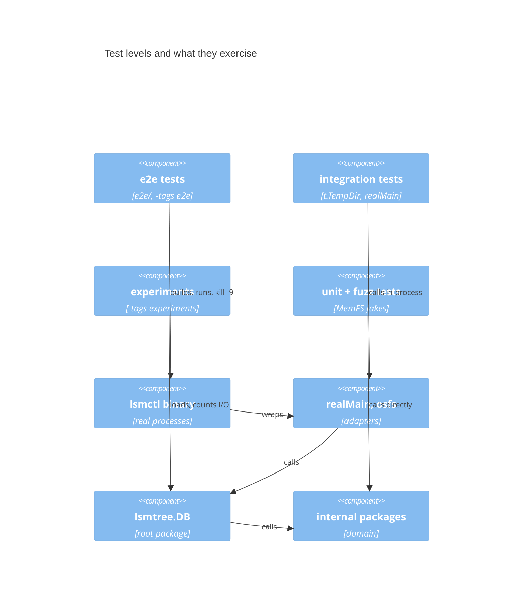

# lsmtree: a test walkthrough

> **Diagrams.** Each diagram appears twice: a Mermaid block that GitHub
> renders, and a Unicode text version for terminals. The text version is
> generated from the source in [`diagrams/`](diagrams/). After editing a
> `.mmd` source, regenerate it with
> `python3 ~/.claude/skills/draw-visual/scripts/render.py --update docs/walkthroughs/lsmtree/tests.md`.
> The `.mmd` source and the Mermaid block next to it describe the same
> picture, so change them together.

This walks through every test file in [`lsmtree/`](../../../lsmtree/),
grouped as in [`lsmtree/TESTS.md`](../../../lsmtree/TESTS.md), which
follows the categories in the repo's [testing approach](../../testing.md)
and adds a last group for the experiments. For each group it says what
that kind of test buys and which bugs it catches, then for each file what
it checks, a test worth reading, and a command that runs just that file.
The code itself is in [code.md](code.md).

Every command runs from the repository root. `go -C lsmtree` runs `go`
inside `lsmtree/`; add `-v` to see each test by name. A fuzz command
without `-fuzz` runs only the seed corpus, which is what plain `go test`
does. The e2e and experiments suites need their build tags.

The one property the whole suite circles around: **no acknowledged write
is lost, no stale value is read, and no deleted key comes back**, through
any sequence of writes, flushes, compactions, reopens, crashes, and
filesystem faults. Each group attacks it from a different side.

## The pyramid

Which components each level of test exercises. GitHub renders the
Mermaid; the text version below is for terminals.



<!-- draw-visual: diagrams/tests-pyramid.mmd -->
```text
┌─────────────────┐    ┌─────────────────┐    ┌───────────┐    ┌───────────┐
│    e2e tests    │    │integration tests│    │experiments│    │unit + fuzz│
└────────┬────────┘    └────────┬────────┘    └─────┬─────┘    └─────┬─────┘
         │                      │                   │                │
         1                      │                   │                │
         ▼                      │                   │                │
┌─────────────────┐             │                   │                │
│  lsmctl binary  │             │                   │                │
└────────┬────────┘             │                   │                │
         │                      │                   │                │
         5                      │                   │                │
         ▼                      │                   │                │
┌─────────────────┐             │                   │                │
│  realMain, osfs │◄─────2──────┘             ┌─────┘                │
└────────┬────────┘                           │                      │
         │                                    │                      │
         5                                    │                      │
         ▼                                    │                      │
┌─────────────────┐                           │                      │
│    lsmtree.DB   │◄4─────────────────────────┘                      │
└────────┬────────┘                                            ┌─────┘
         │                                                     │
         5                                                     │
         ▼                                                     │
┌─────────────────┐                                            │
│internal packages│◄────────────────────3──────────────────────┘
└─────────────────┘
```

1. e2e tests build `lsmctl` and run it, one process per command, against
   a store in a temp dir. They check results by opening the store with
   the library, not by trusting `lsmctl`'s output alone.
2. Integration tests run one adapter against the real filesystem in the
   same process: `osfs`, the manifest on disk, or `realMain` with a temp
   store.
3. Unit and fuzz tests call the domain packages directly, and the root
   package's `DB` tests run the whole store on `vfstest.MemFS`, which
   injects faults and simulates crashes.
4. The experiments drive the `DB` on `countfs` over `MemFS` and compare
   the counts with the paper's formulas.
5. Each level also runs everything below it.

The contract suites sit across levels 2 and 3: `FSContract` runs against
`MemFS`, `countfs`, and `osfs`, and the iterator `Contract` against every
iterator, so a unit test over a fake says something about the real
thing.

| Level | Files | Speed |
|-------|-------|-------|
| Unit | groups 1–5 (all on `MemFS` or in memory) | milliseconds; the fault sweep takes a few seconds |
| Integration | group 6 | milliseconds to seconds |
| System / e2e | group 7 | seconds; builds the binary first |
| Measurement | group 8 | about 5 seconds |

## 1. Specification-based unit tests

**What they buy.** Each test comes from a documented rule: a doc
comment's `pre:`/`post:` lines, a type's `Invariant:`, or a section of
[DESIGN.md](../../../lsmtree/DESIGN.md). They pick partitions and
boundaries: 0, 1, and many entries; a key of 0, 1, max, and max+1 bytes;
a table exactly one block long and one entry past it; a level exactly at
its target and one byte over. A wrong answer for a whole class of input
shows up as one named failure. They run in milliseconds on `MemFS`, so
most rules are tested here. They catch off-by-one boundaries, wrong
orderings (newest version first), and formats that drift from the spec.
They don't find sequences nobody thought of; group 5 does that.

### `internal/keys/keys_test.go`

`Entry.Validate` at every limit (empty key, `MaxKeySize` and one over,
`MaxValueSize` and one over, a bad kind, a tombstone with a value),
`Compare` (user key ascending, then newest seq first), and `Clone`
sharing no memory.

Worth reading: `TestCompare`, which is the one order every sorted
structure in the store uses.

```sh
go -C lsmtree test ./internal/keys
```

### `internal/codec/codec_test.go`

The entry encoding byte for byte (`TestAppendEntryLayout`), round trips,
decoded slices that alias the input but are capped so an append can't
overwrite what follows, malformed input rejected (truncations,
non-minimal varints, over-limit lengths, bad kinds), the limits
accepted, and that `Checksum` is CRC32-C.

Worth reading: `TestDecodeAliasesInputWithCappedSlices`, a subtle
aliasing rule turned into a test.

```sh
go -C lsmtree test -run '^Test' ./internal/codec
```

### `internal/memtable/memtable_test.go`

The skip list: `Get` across versions and tombstones, iteration yields
every version, `Add` copies its buffers, `Len` and `Size`, `Size` never
shrinks, many random adds, and the same seed builds the same shape. It
also runs the iterator contract (`TestIteratorContract`, group 4), two
structural tests (group 3), and `BenchmarkAdd` and `BenchmarkGet`.

Worth reading: `TestSameSeedSameShape`, which is why a failing fuzz
input reproduces.

```sh
go -C lsmtree test -run '^Test' ./internal/memtable
go -C lsmtree test -run '^$' -bench 'BenchmarkAdd$|BenchmarkGet$' ./internal/memtable
```

### `internal/bloom/bloom_test.go`

`Probes`, the false-positive formula, filter size and k, an empty
filter, damaged filters answering "maybe", no false negatives, a
measured false-positive rate that matches `FalsePositiveRate` for 10,000
keys, and a pinned hash. Two structural tests check the bits-per-key
assertions (group 3).

Worth reading: `TestFilterIsStable`. Filters are written to disk, so a
change to the hash would make every existing table give false
negatives: a silent data loss that only a pinned value catches.

```sh
go -C lsmtree test -run '^Test' ./internal/bloom
```

### `internal/vfs/vfstest/memfs_test.go`

The fake's crash model, tested as a spec in its own right, because
every crash test in the project trusts it: unsynced bytes are lost,
creates, renames, and removes are undone until `SyncDir`, `SyncDir` is
ordered across directories (an ordered metadata journal), `CrashTorn`
keeps a prefix of unsynced bytes and keeps renames atomic, a crash
invalidates open handles and locks, and `FailNth` fails exactly one call
with no effect. It also runs `FSContract` (group 4).

Worth reading: `TestCrashKeepsOnlyDurableState`, which walks the
durability model in [`vfs.go`](../../../lsmtree/internal/vfs/vfs.go)
step by step.

```sh
go -C lsmtree test -run 'TestCrash|TestSync|TestFailNth|TestFaultsReachFileOperations|TestSizeIsAFaultPoint' ./internal/vfs/vfstest
```

### `internal/wal/wal_test.go` and `internal/wal/helpers_test.go`

Round trip; the record layout from DESIGN.md §5, byte for byte; a log
truncated at **every** byte offset keeps exactly the records that end
before the cut; a flipped byte drops that record and every record after
it; impossible lengths and payloads that pass the CRC but don't decode
are dropped whole; `Size` and use after close. `helpers_test.go` is not
a test: it builds logs, replays them, checks prefixes, and recomputes
the CRC independently of the package.

Worth reading: `TestFlippedByteDropsRecordAndRest`. It pins the choice
the package comment explains: a bad record in the middle is treated as
a torn tail, so recovery keeps a prefix.

```sh
go -C lsmtree test -run 'TestRoundTrip|TestRecordLayout|TestTornTailAtEveryOffset|TestFlippedByteDropsRecordAndRest|TestReplayRejectsInvalidRecords|TestWriterSizeCountsAppendedBytes|TestWriterAfterClose|TestAppendAssertsPreconditions' ./internal/wal
```

### `internal/sstable/sstable_test.go` and `internal/sstable/helpers_test.go`

An empty table is refused; round trips at 0, 1, and many blocks, on and
just past a block boundary; the `Summary`; `Add` copies its input;
`EstimatedSize`; `Get` hits and every kind of miss (before the first
key, after the last, between keys in a block, between blocks); a miss
the filter rules out reads no block; no filter means no Bloom checks;
iterators read blocks lazily. Two structural tests live here too
(group 3). `helpers_test.go` writes, opens, and builds tables on a
`MemFS`.

Worth reading: `TestBloomNegativesAvoidBlockReads`, the point of the
filter as a counted fact, and `TestRoundTripAtBlockBoundaries`.

```sh
go -C lsmtree test -run 'TestFinishWithNoEntriesFails|TestRoundTripAtBlockBoundaries|TestSummary|TestAddCopiesItsInput|TestEstimatedSize|TestGet|TestBloomNegativesAvoidBlockReads|TestNoFilterMeansNoBloomChecks|TestIteratorReadsBlocksLazily' ./internal/sstable
```

### `internal/iterator/merging_test.go`

The merging iterator with zero children; versions of one key spread
over several sources (memtable, L0, L1) come out newest first; and
`SeekGE` repositions every child, including exhausted ones.

Worth reading: `TestMergingInterleaves`, the LSM read case in
miniature.

```sh
go -C lsmtree test -run 'TestMerging(ZeroChildren|Interleaves|Repositions)' ./internal/iterator
```

### `internal/iterator/dedup_test.go` and `internal/iterator/helpers_test.go`

Newest-wins: one version per key, with and without dropping
tombstones; `SeekGE` onto a deleted key skips to the next live one.
`helpers_test.go` holds `scriptIter`, a fake iterator that walks entries
with no order checks and fails on demand, for groups 2 and 3.

Worth reading: `TestDedupSeekGE`.

```sh
go -C lsmtree test -run 'TestDedup$|TestDedupSeekGE' ./internal/iterator
```

### `internal/meta/meta_test.go`

`FileMeta.Overlaps`; `Version.Validate` partitions (L0 may overlap, L1+
may not, file numbers below `NextFileNum`, `MaxSeq` at most `LastSeq`,
duplicate numbers, too many cursors); `AddL0`; `Clone` independence;
file name parsing. Two structural tests (group 3).

Worth reading: `TestValidate`, the `Version` invariant as a table.

```sh
go -C lsmtree test -run '^Test' ./internal/meta
```

### `internal/compaction/compaction_test.go`

The planner with plain structs: which level compacts (L0 at its trigger,
a level exactly at target versus one byte over, ties to the shallower
level, never the last level); the cursor picks the first table after it
and wraps; overlaps below; an L0 plan takes every L0 table and every L1
table in their combined range, even one in a gap; the bottom flag;
`Apply` and its cursor update. `NextInput` agrees with `Pick` on every
cursor.

Worth reading: `TestPickCursorSweeps`. It feeds each plan's cursor into
the next `Pick`, the way `Apply` stores it, and checks the cursor visits
every table once and wraps: the paper's Figure 2.2 as a test.

```sh
go -C lsmtree test -run '^Test(Pick|Apply)' ./internal/compaction
```

### `internal/manifest/manifest_test.go`

`Encode`/`Decode` round trip; the readable format (one compact JSON
line, hex keys and cursors, a CRC trailer line); a manifest written
before cursors existed; corrupt inputs; a valid manifest cut at every
length is rejected. One structural test (group 3).

Worth reading: `TestEncodeReadable`, which pins the format a human
reads with `head -n 1 MANIFEST | jq .`.

```sh
go -C lsmtree test -run 'TestRoundTrip|TestEncodeReadable|TestDecodeWithoutCursors|TestDecodeCorrupt|TestDecodeEveryTruncation|TestEncodeAssertsInvariant' ./internal/manifest
```

### `db_test.go`

The public API on `MemFS`: get, put, and delete partitions; key and
value limits (0, 1, max, max+1) that change nothing; scan bounds
(`[start, end)`, nil ends); data surviving reopen with and without
`SyncWrites`; deletes never resurrecting; use after close; one opener at
a time; bad options; a corrupt table reported as `ErrCorrupt`; events
and stats; `Stats.Next` really naming the next compaction across
reopens; compaction after a reopen. Also `assertWellFormed`, used by the
failure tests, and one structural test (group 3).

Worth reading: `TestDeleteDoesNotResurrect` ("the classic LSM bug: a
tombstone dropped too early lets an older value on a deeper level come
back") and `TestStatsNextIsTheNextCompaction`, which checks the `->` in
`lsmctl dump` against what compaction actually does, across reopens
and a cursor wrap.

```sh
go -C lsmtree test -run 'TestGetPutDelete|TestKeyAndValueLimits|TestScanBounds|TestDataSurvivesReopen|TestDeleteDoesNotResurrect|TestUseAfterClose|TestOneOpenerAtATime|TestBadOptions|TestCorruptTableIsReported|TestEventsAndStats|TestStatsL0TriggerDefault|TestStatsNextIsTheNextCompaction|TestCompactAfterReopen' .
```

`TestCompactAfterReopen` pins a rule documented in `DB.Flush`: the flush
at Open never compacts, so `Compact` must compact even with an empty
memtable. The e2e `TestCompactShrinksL0` covers the same path through
real processes (group 7).

### `helpers_test.go`

Not a test. `tinyOptions` makes every mechanism run often (a 512-byte
memtable, 64-byte blocks, ratio 2, four levels, an L0 trigger of 2, so
data reaches the last level within a few dozen writes). Also `put`,
`get`, `del`, `dump` (which asserts `Scan` order), `checkModel`, and
`diff`, used by the root tests in groups 1, 2, and 5.

The `errs`, `assert`, `cli`, and `logx` helpers are tested in the
`shared` module:

```sh
go -C shared test ./...
```

## 2. Failure-path and regression unit tests

**What they buy.** Spec tests check what happens when everything works.
These make the filesystem fail at one exact call, or crash at one exact
point, and check three things: what the error promises, what is on
disk, and what a reopen recovers. Real disks almost never fail on
demand; `MemFS`'s `SetFault`, `FailNth`, `Crash`, and `CrashTorn` make
them fail precisely and repeatably. They catch write-ordering bugs (a
file deleted before the commit that stops naming it), errors that lie
about state ("nothing changed" when something did), I/O errors mistaken
for corruption, and torn writes that recovery doesn't handle.

**A real catch.** `TestEveryFaultLeavesARecoverableStore` found the
*ambiguous-commit* bug. The first version of compaction deleted its
output tables on any manifest error. When only the directory sync after
the rename failed, the new manifest was already in place and named
those tables, so the reopened store pointed at deleted files. Now a
failed commit leaves every file, and Open deletes the ones the surviving
manifest doesn't name
([DESIGN.md §5](../../../lsmtree/DESIGN.md#5-on-disk-formats),
[code.md stop 13](code.md#13-compaction-copy-commit-clean-up)).

### `internal/wal/failure_test.go`

`Replay` returns a callback's error unchanged, and returns read and
size errors instead of treating them as a torn tail; a failed write or
sync makes the writer refuse all further work; close errors.

Worth reading: `TestReplayReturnsReadError`. Treating an I/O error as a
torn tail would silently drop the rest of a good log.

```sh
go -C lsmtree test -run 'TestReplayReturns|TestReplayReadErrorMidway|TestWriterFailureIsSticky|TestWriterCloseError' ./internal/wal
```

### `internal/wal/crash_test.go`

`TestCrashRecoversSyncedPrefix`: append, sync part of the way, append
more, then `CrashTorn` tears the unsynced tail at a random byte. Replay
must return a prefix of the appended entries at least as long as the
synced part. This is the prefix property at its source.

```sh
go -C lsmtree test -run 'TestCrashRecoversSyncedPrefix' ./internal/wal
```

### `internal/sstable/sstable_failure_test.go`

Each failed `Write`, and the `Sync`, reaches the caller from `Add` or
`Finish` as an I/O error, not corruption, and the file is closed;
failed reads are I/O errors from `Open`, `Get`, and the iterator.

Worth reading: `TestWriterSurfacesEachIOFailure`.

```sh
go -C lsmtree test -run 'TestWriterSurfacesEachIOFailure|TestReaderSurfacesReadFailures' ./internal/sstable
```

### `internal/sstable/sstable_corrupt_test.go`

Every byte flip is detected as `ErrCorrupt`, never a panic or a wrong
answer; where each region's damage is reported (filter, index, and
footer at `Open`, a data block only when read); sticky iterator errors;
truncated tables and trailing garbage; and blocks and indexes that pass
their CRC but are malformed, as a buggy writer could produce (through
`DecodeBlock` and `DecodeIndex` from `export_test.go`).

Worth reading: `TestEveryByteFlipIsDetected`, and its guard
`TestUndamagedTablePassesCheck`: the checker must accept a good table,
or the flip test proves nothing.

```sh
go -C lsmtree test -run 'TestEveryByteFlipIsDetected|TestFlipInEachRegion|TestIteratorErrorIsSticky|TestTruncatedTablesAreCorrupt|TestTrailingGarbageIsCorrupt|TestUndamagedTablePassesCheck|TestDecodeBlockRejects|TestDecodeIndexRejects' ./internal/sstable
```

### `internal/iterator/errors_test.go`

A child's error mid-stream or while positioning stops the merge and
sticks; `Close` returns the first child's `Close` error even if the
merge never saw it; dedup passes errors through.

```sh
go -C lsmtree test -run 'TestMergingChildError|TestMergingCloseReturnsFirstChildError|TestDedupPropagatesError' ./internal/iterator
```

### `internal/manifest/write_test.go`

`Write` and `Read` on `MemFS`: fail each step of the atomic install
(create, write, sync, close, rename, directory sync), then crash, and
the store comes back with the old manifest or the new one, never an
error or a mix; fail the nth call for **every** n, so a step added to
`Write` later is covered too; torn crashes after a failed or successful
write; read failures.

Worth reading: `TestWriteFailureThenCrash`. Its directory-sync case is
the unit-level version of the ambiguous commit: the write "failed", but
the new manifest may be the one that survives.

```sh
go -C lsmtree test -run '^Test(Write|Read)' ./internal/manifest
```

### `db_failure_test.go`

The fault sweep. `TestEveryFaultLeavesARecoverableStore` first counts
every filesystem call of each kind a 250-write workload makes (with
flushes and compactions), then reruns the workload once per call,
failing the first 100 calls of each op and an even sample of about 100
more, ending with the very last. After the fault, the store must refuse
writes with `ErrWritesFailed` and a well-formed error, still answer
reads, and after a fault-free reopen hold every acknowledged write. The
one write whose call failed may or may not have landed.
`TestFaultDuringOpen` does the same for each call Open makes while
recovering. Under `-short` (`make check`'s race pass) the sweep fails the
first 10 calls of each op and a sample of about 10.

Worth reading: `runWithFault`, and its "uncertain" key: the test accepts
either state for the one write whose call failed, which is exactly the
ambiguity a real store has to live with.

```sh
go -C lsmtree test -run 'TestEveryFaultLeavesARecoverableStore|TestFaultDuringOpen' -v .
```

## 3. Structural tests: proving the assertions can fail

**What they buy.** An assertion that has never failed proves nothing:
it might check the wrong thing, or never run. Coverage marks its failing
branch as uncovered. These tests break each contract on purpose (a
broken plan, a corrupted skip list, a forgotten reader) and expect the
panic, through `shared/assert/asserttest.Panics`. They catch a check
that was deleted, typed backwards, or compiled out by mistake. They skip
under `-tags noassert`.

### `internal/iterator/assert_test.go`

The merge trips on two children holding the same `(key, seq)` (reused
sequence numbers) and on a child that yields out of order; dedup and the
slice iterator trip on unsorted input.

```sh
go -C lsmtree test -run 'Asserts' ./internal/iterator
```

### `internal/compaction/assert_test.go` and `internal/compaction/export_test.go`

`TestAssertionsTrip`: a plan that misses or adds an overlapping table, a
wrong bottom flag, no inputs, an input on the wrong level; an `Apply`
that would corrupt the `Version`; bad options or too many levels passed
to `Pick`. `export_test.go` exposes `checkPlan` as `CheckPlan`.

```sh
go -C lsmtree test -run 'TestAssertionsTrip' ./internal/compaction
```

### `export_test.go` (root)

Not a test. It adds `DB.CheckInvariant` and `DB.ForgetReader` to the
`lsmtree` package during tests. `TestDBInvariantTrips` in `db_test.go`
flushes a table, drops its reader with `ForgetReader`, and expects the
"every live table has an open reader" check to trip.

```sh
go -C lsmtree test -run 'TestDBInvariantTrips' .
```

### Structural tests in other files

| Contract | Test | File |
|----------|------|------|
| memtable `Add` preconditions; the full skip-list walk | `TestAddAssertions`, `TestCheckInvariantCatchesCorruption` | `internal/memtable/memtable_test.go` |
| `bitsPerKey >= 1` | `TestNewBuilderAssertsBitsPerKey`, `TestFalsePositiveRateAssertsBitsPerKey` | `internal/bloom/bloom_test.go` |
| WAL `Append` preconditions | `TestAppendAssertsPreconditions` | `internal/wal/wal_test.go` |
| keys added in increasing order; bytes written end where the last block ends | `TestAddOutOfOrderTripsAssertion`, `TestWriterInvariantTrips` | `internal/sstable/sstable_test.go` (with `Writer.CheckInvariant` and `SkewOffset` from `export_test.go`) |
| the `Version` invariant | `TestCheckInvariantTrips`, `TestAddL0Trips` | `internal/meta/meta_test.go` |
| `Encode` refuses a broken `Version` | `TestEncodeAssertsInvariant` | `internal/manifest/manifest_test.go` |

```sh
go -C lsmtree test -run 'TestAddAssertions|TestCheckInvariantCatchesCorruption' ./internal/memtable
go -C lsmtree test -run 'Asserts' ./internal/bloom
go -C lsmtree test -run 'TestAppendAssertsPreconditions' ./internal/wal
go -C lsmtree test -run 'TestAddOutOfOrderTripsAssertion|TestWriterInvariantTrips' ./internal/sstable
go -C lsmtree test -run 'TestCheckInvariantTrips|TestAddL0Trips' ./internal/meta
go -C lsmtree test -run 'TestEncodeAssertsInvariant' ./internal/manifest
```

## 4. Contract tests

**What they buy.** Almost every unit test runs on `vfstest.MemFS`, and
the store's crash guarantees are only as good as `MemFS`'s model of a
real disk. If the fake differs from `osfs` (say it lets a reader keep
reading a removed file when the real one doesn't, or allows two locks),
the unit tests pass and prove nothing. One suite per interface, run
against every implementation, keeps the fakes honest (Liskov
substitution). The same goes for iterators: the merge treats the
memtable, an SSTable, and another merge as interchangeable, so they all
pass one contract.

### `internal/vfs/vfstest/memfs.go` and `internal/vfs/vfstest/helpers.go`

Not tests. `MemFS` is the in-memory `vfs.FS` behind groups 1, 2, and 5:
`SetFault` and `FailNth` inject a failure into any operation, `Crash`
keeps only what was made durable, and `CrashTorn` also keeps a random
prefix of unsynced bytes and of pending namespace changes.
`helpers.go` has `WriteFile` and `ReadFile` for any `vfs.FS`.

### `internal/vfs/vfstest/contract.go`

`FSContract`: write then read, empty files, re-create, `Size` tracking
writes, `ReadAt` boundaries, missing files are `fs.ErrNotExist`, rename
replaces its target, remove then list, `List` sorted and files only,
`MkdirAll` idempotent, a reader survives `Remove`, use after close, an
exclusive `Lock`, and the lock file showing in `List`. It runs against
`MemFS` (`memfs_test.go`), `countfs` (`countfs_test.go`), and `osfs`
(`internal/osfs/osfs_test.go`).

```sh
go -C lsmtree test -run 'Contract' ./internal/vfs/... ./internal/osfs
```

### `internal/vfs/countfs/countfs_test.go`

The counting wrapper passes `FSContract` (it must change no behaviour),
classifies files by kind (`wal`, `table`, `manifest`, `other`), and
counts bytes and calls per kind.

```sh
go -C lsmtree test -run 'TestContract|TestKindOf|TestCountsByKind' ./internal/vfs/countfs
```

### `internal/iterator/itertest/contract.go`

Not a test file. `Contract(t, build)`: not valid before positioning;
`First` walks every entry at 0, 1, 2, 100, and 1,000 entries; `SeekGE`
lands on the newest version; seek then next stays in order; repositioning
after exhaustion; tombstones and empty values; `Close`. A builder may
skip inputs its implementation can't hold (an SSTable is never empty
and holds one version per key). Also the `NewestOnly` reference model
and entry helpers (`Put`, `Del`, `Entries`, `Drain`).

### `internal/iterator/contract_test.go`

Runs `Contract` against the slice iterator, the merging iterator (with
the entries split across children several ways), dedup, and dedup over
merging: the stack reads use.

```sh
go -C lsmtree test -run 'Contract' ./internal/iterator
```

### `internal/sstable/sstable_contract_test.go`

Runs `Contract` against an SSTable's iterator. The memtable runs it in
`memtable_test.go`.

```sh
go -C lsmtree test -run 'TestIteratorContract' ./internal/sstable ./internal/memtable
```

## 5. Property-based and fuzz tests

**What they buy.** Instead of picked examples, each target states a
property that must hold for every input, and Go's coverage-guided fuzzer
searches for an input that breaks it. Model-based targets read the
input as a script of operations and compare the store with a plain map,
so they find bad *sequences* nobody would write by hand: a delete,
then a flush, then a compaction into the bottom level, then a reopen.
With assertions on, every invariant in the code (the skip list, the
merge order, the plan, the `Version`) is an extra oracle on every input.
Decoder targets feed arbitrary bytes to everything that reads from disk
and require `ErrCorrupt`, never a panic.

Run a target's seeds with `-run`, or search for new failures with
`-run='^$' -fuzz=<Target>`, one target at a time. No fuzzer-found
failures are saved under `testdata/fuzz/` yet; the seeds live in the
fuzz functions and run with plain `go test`.

### `internal/codec/codec_fuzz_test.go`: `FuzzDecodeEntry`

Arbitrary bytes never panic, and whatever decodes is a valid entry whose
canonical encoding is exactly the bytes consumed.

```sh
go -C lsmtree test -run 'FuzzDecodeEntry' ./internal/codec
go -C lsmtree test -run='^$' -fuzz=FuzzDecodeEntry -fuzztime=30s ./internal/codec
```

### `internal/memtable/memtable_fuzz_test.go`: `FuzzMemtable`

Model-based: a script of puts, deletes, `Get`, and `SeekGE` checked
against a sorted slice, with the skip-list invariant asserted along the
way.

```sh
go -C lsmtree test -run 'FuzzMemtable' ./internal/memtable
go -C lsmtree test -run='^$' -fuzz=FuzzMemtable -fuzztime=30s ./internal/memtable
```

### `internal/bloom/bloom_fuzz_test.go`: `FuzzBloomNoFalseNegatives`

The input split into keys: every added key is reported as maybe present.
The raw input probed as a filter never panics.

```sh
go -C lsmtree test -run 'FuzzBloomNoFalseNegatives' ./internal/bloom
go -C lsmtree test -run='^$' -fuzz=FuzzBloomNoFalseNegatives -fuzztime=30s ./internal/bloom
```

### `internal/wal/wal_fuzz_test.go`: `FuzzWALRoundTrip`, `FuzzWALReplay`

`FuzzWALRoundTrip`: any list of valid entries round trips exactly, with
nothing dropped. `FuzzWALReplay`: arbitrary bytes never make `Replay`
panic or fail, every entry it returns is valid, and the report accounts
for every byte.

```sh
go -C lsmtree test -run 'FuzzWAL' ./internal/wal
go -C lsmtree test -run='^$' -fuzz=FuzzWALRoundTrip -fuzztime=30s ./internal/wal
go -C lsmtree test -run='^$' -fuzz=FuzzWALReplay -fuzztime=30s ./internal/wal
```

### `internal/sstable/sstable_fuzz_test.go` and `internal/sstable/export_test.go`

`FuzzSSTableRoundTrip`: fuzzer-chosen entries with a tiny block size come
back through the iterator, `SeekGE`, and `Get`. `FuzzSSTableOpen`:
arbitrary bytes, seeded with valid tables so mutations explore
near-valid files, give `ErrCorrupt` from `Open`, the iterator, or `Get`,
never a panic. `FuzzDecoders`: the block and index decoders that sit
behind CRCs random bytes almost never pass, reached through
`export_test.go`'s `DecodeBlock` and `DecodeIndex`.

```sh
go -C lsmtree test -run 'FuzzSSTable|FuzzDecoders' ./internal/sstable
go -C lsmtree test -run='^$' -fuzz=FuzzSSTableRoundTrip -fuzztime=30s ./internal/sstable
go -C lsmtree test -run='^$' -fuzz=FuzzSSTableOpen -fuzztime=30s ./internal/sstable
go -C lsmtree test -run='^$' -fuzz=FuzzDecoders -fuzztime=30s ./internal/sstable
```

### `internal/iterator/merging_fuzz_test.go`: `FuzzMergeIterator`

The first byte picks 1–5 children; each later byte is one entry with a
key, a kind, and a child. The merge must equal a sort of all entries,
and dedup over it must equal the `NewestOnly` reference.

```sh
go -C lsmtree test -run 'FuzzMergeIterator' ./internal/iterator
go -C lsmtree test -run='^$' -fuzz=FuzzMergeIterator -fuzztime=30s ./internal/iterator
```

### `internal/compaction/compaction_fuzz_test.go`: `FuzzPlan`

Random valid versions, then several rounds of `Pick` and `Apply`, so
each `Pick` follows the cursors the previous `Apply` stored. Every plan
below L0 takes the first table after the cursor, wrapping; `Overlaps` is
exactly the Li+1 tables meeting the inputs' range; `Bottom` is right by
brute force over every deeper table; and `Apply` never changes its
input, keeps the `Version` invariant, leaves every other table in place,
and moves only that level's cursor.

```sh
go -C lsmtree test -run 'FuzzPlan' ./internal/compaction
go -C lsmtree test -run='^$' -fuzz=FuzzPlan -fuzztime=30s ./internal/compaction
```

### `internal/manifest/manifest_fuzz_test.go` and `internal/manifest/export_test.go`

`FuzzManifestDecode`: arbitrary bytes decode to a valid `Version` or an
`ErrCorrupt`. `FuzzManifestBody`: the same, but each input is sealed
with a valid checksum first (`Seal`, from `export_test.go`), because
random bytes almost never pass the CRC and the fuzzer would otherwise
never reach the JSON and invariant checks behind it.

```sh
go -C lsmtree test -run 'FuzzManifest' ./internal/manifest
go -C lsmtree test -run='^$' -fuzz=FuzzManifestDecode -fuzztime=30s ./internal/manifest
go -C lsmtree test -run='^$' -fuzz=FuzzManifestBody -fuzztime=30s ./internal/manifest
```

### `db_model_fuzz_test.go`: `FuzzDBModel`, `FuzzCrashRecovery`, `TestModelLongRun`

The most valuable tests in the project.

`FuzzDBModel` reads bytes as up to 400 steps of put, delete, get, scan,
flush, compact, close-and-reopen, and crash-and-reopen, over ten keys
that include `"\x00"`, `"\xff"`, and `"\xff\xff"`, with `tinyOptions` and
`SyncWrites` on. A plain map is the model. Every get and scan must
agree with it, and so must the whole store at the end: no lost writes,
no stale reads, no resurrected deletes, even after a crash.

`FuzzCrashRecovery` checks the prefix property without `SyncWrites`. It
keeps the model's state after every write. After a clean or torn crash
(a fuzzer-chosen seed drives `CrashTorn`), the store must equal the
state after *some* prefix of the writes, at least as long as the last
explicit `Flush`: it may lose recent writes, never an older one while
keeping a newer one.

`TestModelLongRun` is the fixed-seed counterpart: 20,000 steps over 400
keys, long enough to fill all four levels (2,000 under `-short`, which
still reach the last level).

Worth reading: `FuzzCrashRecovery`'s `recoverFrom`, which searches the
history from newest to oldest for the prefix recovery chose.

```sh
go -C lsmtree test -run 'FuzzDBModel|FuzzCrashRecovery|TestModelLongRun' .
go -C lsmtree test -run='^$' -fuzz=FuzzDBModel -fuzztime=30s .
go -C lsmtree test -run='^$' -fuzz=FuzzCrashRecovery -fuzztime=30s .
go -C lsmtree test -run 'TestModelLongRun' -v .
```

## 6. Integration tests

**What they buy.** Unit tests never touch a real disk, so they can't
catch a wrong `os.OpenFile` flag, a directory fsync that fails on a real
filesystem, a lock that doesn't exclude, or a CLI that turns a known
error into a bug report. These run one adapter against real
infrastructure in the test process (`t.TempDir()`), including the
failure paths: a missing directory, a flipped byte on disk, a locked
store, a corrupt table.

### `internal/osfs/osfs_test.go`

The real filesystem in a temp dir: `FSContract`, `SyncDir` and `Lock` in
a missing directory, and `List` skipping symlinks.

```sh
go -C lsmtree test -v ./internal/osfs
```

### `internal/manifest/osfs_test.go`

`TestOSFS`: the manifest written and read on the real filesystem, and a
byte flipped on disk caught by the CRC.

```sh
go -C lsmtree test -run 'TestOSFS' ./internal/manifest
```

### `cmd/lsmctl/main_test.go`

`realMain` in-process with a temp store: a known edge case exits 1 with
its message and a log ID; a raw error and an injected panic are
reported as bugs (exit 70) with the stack in the log, not on screen;
argument errors exit 1 with no "bug" wording, and only a missing
command or a bad flag exits 2; every command run as separate calls, as
separate processes would; `load`, `load -sync` printing acknowledged
keys, and an interrupted load; a locked store and a corrupt table as
friendly errors; the log file next to the store; key quoting (`show`);
`dump`'s `->` marker; `parseSize` and `human`.

Worth reading: `TestPanicIsReportedAsBug`, which swaps `runCommand` to
inject a panic. The generic `cli.Reporter` is tested in
`shared/cli/cli_test.go`.

```sh
go -C lsmtree test -v ./cmd/lsmctl
```

## 7. System / e2e tests

**What they buy.** Only these run the real binary as separate processes:
flag parsing, a real directory, the OS file lock, `kill -9` in the
middle of a flush or compaction, and the CLI's output format. Every
command is its own process, so every read comes from what an earlier
process left on disk. They catch wiring bugs and anything that only
shows up across process boundaries, such as a state that is correct in
memory but never reached the disk. They take seconds, so they cover the
main flows and the riskiest failures. Where a test needs ground truth,
it opens the store with the library instead of trusting `lsmctl`'s
report about itself. They need `-tags e2e`.

### `e2e/harness_test.go`

`TestMain` builds `lsmctl` once. An `env` is one store in a temp dir with
`lsmctl.log` beside it; its options become `lsmctl` flags, and `inspect`
opens the store with the same options through the library. `wantError`
requires exit 1, a log ID, and no bug report. `startLoad` runs
`lsmctl -sync load` and streams the acknowledged keys; `kill` sends
SIGKILL and returns every key acknowledged before the process died. It
has no tests of its own.

### `e2e/e2e_test.go`

Data persists across processes (`put`, `get`, `scan` with bounds, `del`);
a 4,000-key load builds at least four levels, each above the last within
its target, with `dump` lines under 80 columns; SIGKILL after 50, 300,
and 700 acknowledgements loses no acknowledged write, `verify` passes,
and nothing in the store is garbage; `compact` shrinks L0 after six
`put` processes each left a table; a flipped byte and a truncated table
give a friendly "corrupt" error with a log ID, never a panic; a second
opener fails cleanly while a load holds the lock, and the store works
once the loader is killed.

Worth reading: `TestSigkillLosesNoAcknowledgedWrite`, the paper's
recovery claim through real processes, and `TestLoadBuildsLevels`,
whose `-v` output is the `dump` and `stats` picture the README uses.

```sh
go -C lsmtree test -tags e2e -count=1 -run 'TestPersistsAcrossProcesses|TestLoadBuildsLevels|TestSigkillLosesNoAcknowledgedWrite|TestCompactShrinksL0|TestCorruptTableIsReportedNotPanicked|TestSecondOpenerFailsCleanly' -v ./e2e
go -C lsmtree test -tags e2e -count=1 -run 'TestSigkillLosesNoAcknowledgedWrite' -v ./e2e
```

### `e2e/model_test.go`

`TestWorkloadMatchesModel`: 120 fixed-seed steps of puts, overwrites,
deletes, flushes, and compactions, one process per step, with a
100-byte memtable so data moves through every level, and keys that sort
in awkward places or need quoting in `scan` output. A map records what
the store should hold. It is the deterministic counterpart of
`FuzzDBModel`: the same rule, through real files, restarts, and the
CLI's argument handling.

```sh
go -C lsmtree test -tags e2e -count=1 -run 'TestWorkloadMatchesModel' -v ./e2e
```

## 8. Measurement (experiments)

**What they buy.** They test the paper's argument, not the code's
correctness: does batching make M entries share each page write
(formula 3.2), does write amplification grow with the size ratio, are
equal ratios best (Theorem 3.1), and how much do finds cost. They count
bytes and blocks through `countfs` on `MemFS`, never time, so every run
on every machine gives the same numbers. Each asserts only a loose
expected shape, so the suite also catches regressions that change the
store's I/O: a compaction that rewrites too much, a filter that stops
filtering, a flush that writes twice. They need `-tags experiments`, and
write CSV and `events.jsonl` to `EXPERIMENT_RESULTS_DIR` when it is set
(`make experiments`, through the shared runner, sets it). Results:
[DESIGN.md §8](../../../lsmtree/DESIGN.md#8-experiments-measuring-the-papers-claims).

### `experiments/helpers_test.go`

Not an experiment. Fixed-size keys and values (16 and 32 bytes, so bytes
and entries are proportional, as the formulas assume), `openDB` on
`countfs.New(vfstest.NewMemFS())` with an event log that copies each
store `Event` to the run's `events.jsonl`, and `TestMain`, which hands
the run to `shared/experiment`. The tests use that package's
`experiment.Sweep` (each configuration as a parallel subtest) and
`experiment.Table` (`t.Log` output and CSV, plus `runs.csv`, when
results are being saved).

### `experiments/e1_batch_merge_test.go`

`TestE1BatchMerge`: a fixed L1 of 20,000 entries and a varying C0. With
`L0CompactionTrigger` 1, a flush and its L0→L1 compaction are the
paper's C0→C1 merge. Measured M (`NewEntries / OutputBlocks` of that
compaction) must be within 10% of formula 3.2 and grow with S0.

```sh
go -C lsmtree test -tags experiments -count=1 -run TestE1 -v ./experiments
```

### `experiments/e2_write_amp_test.go`

`TestE2WriteAmp`: 100,000 keys, random and sequential, at r = 2, 4, 10,
and 25, with write amplification per level and in total, plus WAL and
manifest bytes from `countfs`. It checks `countfs` agrees with `Stats`,
every random load writes more than 2× the user bytes, sequential keys
cost less and about one copy per level, and a larger r uses no more
levels but costs more on its costliest level.

```sh
go -C lsmtree test -tags experiments -count=1 -run TestE2 -v ./experiments
```

### `experiments/e3_theorem31_test.go`

`TestE3Theorem31`: three levels with S0 and S2 fixed and S1 varied
through `LevelTargets`. Merge I/O per byte inserted must be U-shaped,
lowest within 2× of √(S0·S2), and within 25% of formula 3.7.

```sh
go -C lsmtree test -tags experiments -count=1 -run TestE3 -v ./experiments
```

### `experiments/e4_read_amp_test.go`

`TestE4ReadAmp`: tables probed and blocks read per `Get` for present and
absent keys (absent keys fall between present ones, inside every table's
range), with filters off and at 5, 10, and 20 bits per key. Without
filters an absent key reads at least two blocks; blocks fall as bits
grow; at 10 bits they fall below 10% of the unfiltered cost; the
measured false-positive rate is near `bloom.FalsePositiveRate`.

```sh
go -C lsmtree test -tags experiments -count=1 -run TestE4 -v ./experiments
```

## Run everything

From the repository root:

```sh
make test-lsmtree             # make -C lsmtree check e2e
make -C lsmtree check         # vet (all tags), go test -race -short, then vet and test with -tags noassert, gofmt check
make -C lsmtree e2e           # go test -tags e2e -count=1 -v ./e2e
make -C lsmtree demo          # scripts/demo.sh: builds levels, kill -9 a synced load, recovers; temp dirs removed on exit
make -C lsmtree experiments   # ../shared/scripts/experiments.sh: E1-E4 to results/<run>/, then the DuckDB tables if duckdb is installed
make experiments-lsmtree RUN=E3   # the same, from the root, for the experiments matching a go test -run pattern
```

`make check`'s race pass uses `-short`, which shrinks the two long root
tests: the fault sweep samples fewer faults per op and
`TestModelLongRun` runs a tenth of its steps. They are about 10× slower
under the race detector. The `noassert` pass runs their full versions,
so `check` still covers every fault and step. Other targets in
[`lsmtree/Makefile`](../../../lsmtree/Makefile): `make -C lsmtree test`
(plain `go test ./...`), `bench`, `cover`, `build` (`bin/lsmctl`), and
`noassert`. For coverage across unit and e2e runs, see
[testing approach §2](../../testing.md#2-structural-tests-aniche-chapter-3).
